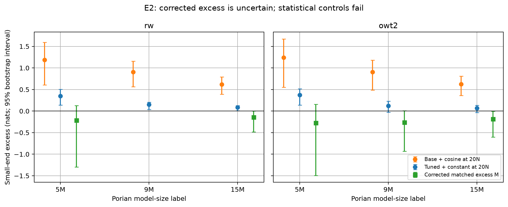
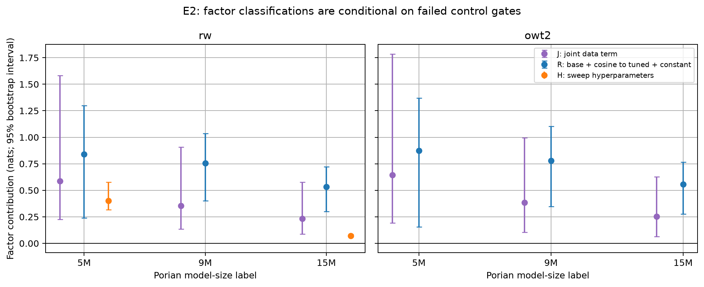
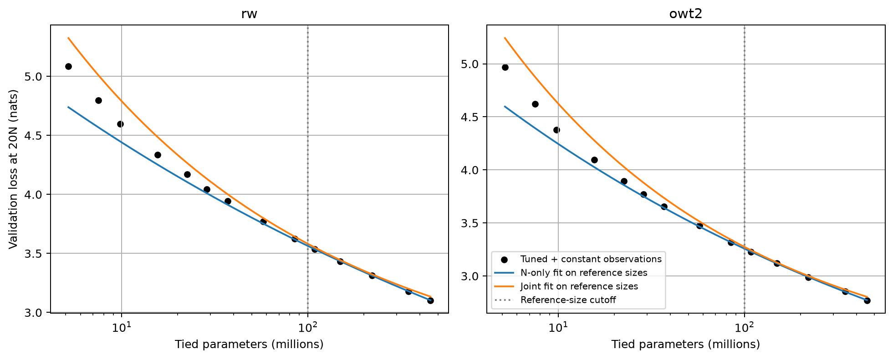
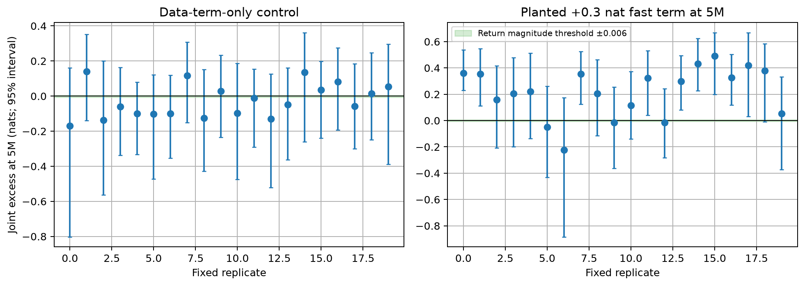

# E2 Results (2026-11-26): token budget, training recipe, and the small end

As of 2026-11-26. By ub9sc (ultimate brando9 scalable coworker).

**Why do the tiniest models live off the scaling curve, and what correction brings them back?** E2 asks whether Porian's small-end misfit is a token-budget or hyperparameter confound.

**Result: scientifically unresolved.** The unchanged preregistered statistical control gates fail after the implementation corrections. The real-data table mechanically reads **(rw: PARTIAL, owt2: PARTIAL)**; these are conditional table classifications, not validated scientific verdicts. No target size meets the return-to-curve criterion. The base-plus-cosine to tuned-plus-constant recipe change reduces the reverse-ladder excess at all three target sizes on both datasets, but the additive joint-law extrapolation overshoots the small-model losses and has broad uncertainty.

Initial code/fits: Claude Code, Opus 5.5 (claude-opus-5-5). Resume, repairs, numerical reruns and reporting: Codex CLI, GPT-6 Astra ultra via Vals; Python CPU on skampere1, nice 15, three processes maximum with BLAS threads fixed to one. These are executed numerical fits and bootstrap calculations, not a model-only reading. Lean and differential testing are not applicable. Package versions and data hashes: [run_environment.json](results/run_environment.json).

PREREG was pushed before the first fit; [the dated amendment](AMENDMENT_2026-11-26.md) was pushed before the revised fits. The original PREREG is unchanged. Original failed controls and summaries remain in [original_2026-11-26](results/original_2026-11-26/).

## Return to the curve

Tied count is primary: N = N_nonemb + 50,432 × width (the legacy DM-2 loader calls this N_total). The input has **975 runs and 16 model sizes**, rather than the 977 stated in the brief. D/N always uses tied N, including the descriptive untied-count analysis. TC means tuned plus constant learning rate; BC means base plus cosine decay. The 20N reverse ladder fits five reference sizes, 108M–455M. Alpha is the fast exponent in the two-term N-only convention; E2 uses a one-term N law and the additive Chinchilla law only.

X is observed loss minus the N-only prediction from reference sizes. M is the joint-law excess, minus the sweep-estimated tuned-recipe correction G on rw. All intervals below are 95% parametric bootstrap intervals in nats. The rw 9M sweep correction is unavailable, so M is unavailable there; no G=0 substitution is made.

| Dataset | Size | X(TC20), nats [95% interval] | M, nats [95% interval] | Two seed SD, nats | Conditional return classification |
|---|---|---|---|---|---|
| rw | 5M | +0.347 [+0.137, +0.503] | -0.216 [-1.295, +0.130] | 0.1238 | UNDETERMINED |
| rw | 9M | +0.149 [+0.038, +0.206] | unavailable | 0.0103 | UNDETERMINED (G unavailable) |
| rw | 15M | +0.083 [+0.007, +0.126] | -0.140 [-0.483, +0.002] | 0.0099 | UNDETERMINED |
| owt2 | 5M | +0.371 [+0.139, +0.519] | -0.275 [-1.495, +0.158] | 0.0247 | UNDETERMINED |
| owt2 | 9M | +0.123 [-0.027, +0.228] | -0.263 [-0.931, +0.005] | 0.0389 | UNDETERMINED |
| owt2 | 15M | +0.067 [-0.032, +0.134] | -0.184 [-0.601, -0.005] | 0.0094 | UNDETERMINED |

RETURNS requires both |M| ≤ two seed SD and an interval containing zero; STAYS OFF requires M above two seed SD and a strictly positive lower bound. A negative overshoot outside the return threshold is UNDETERMINED under the fixed rule. The dataset criterion requires all three RETURNS for CONFOUND EXPLAINS, or at least two STAY OFF for CONFOUND DOES NOT EXPLAIN IT; all other outcomes are PARTIAL.

## How much each factor explains

Positive contribution means a factor reduces the baseline excess. T compares per-size finals with matched 20N. J adds the joint data term. R changes base plus cosine to tuned plus constant. H estimates pure hyperparameter changes from the rw constant-learning-rate sweep. S = R − H includes schedule and remaining recipe differences. G estimates residual mis-tuning of the tuned recipe. These contributions overlap and must not be added as independent causal effects. H uses batch 64 at small sizes, while the actual base recipe uses batch 256; its attribution understates that batch mismatch. The available data do not independently cross tuned/base with decay/constant, so the schedule alone is not identified.

EXPLAINS requires contribution ≥50% of baseline, ≥two seed SD, and lower interval bound >0. PARTLY requires ≥20% of baseline and lower >0. OPPOSITE requires upper <0 and magnitude ≥20% of baseline. A nonpositive baseline gives N/A. A factor explains a dataset only when at least two of its three target-size rows are EXPLAINS. Every classification remains conditional because the controls fail.

| Dataset | Factor | Size | Contribution, nats [95% interval] | % of baseline | Conditional classification |
|---|---|---|---|---|---|
| rw | T, tuned final → 20N | 5M | -33.548 [-277.888, -5.011] | N/A | N/A (no excess) |
| rw | T, base final → 20N | 5M | -117.574 [-592.252, -21.062] | N/A | N/A (no excess) |
| rw | T2, Kaplan → base 20N (secondary) | 5M | -12.575 [-45.006, -4.320] | N/A | N/A (no excess) |
| rw | J, tuned | 5M | +0.586 [+0.226, +1.583] | 168.6% | EXPLAINS |
| rw | J, base | 5M | +0.226 [-0.486, +0.889] | 19.0% | NO |
| rw | R, recipe | 5M | +0.840 [+0.239, +1.298] | 70.7% | EXPLAINS |
| rw | H, sweep hyperparameters | 5M | +0.400 [+0.318, +0.575] | 33.7% | PARTLY |
| rw | S, schedule and rest | 5M | +0.439 [-0.230, +0.863] | 37.0% | NO |
| rw | G, tuned mis-tuning | 5M | -0.023 [-0.103, +0.159] | -6.5% | NO |
| rw | T, tuned final → 20N | 9M | -11.468 [-63.058, -2.182] | N/A | N/A (no excess) |
| rw | T, base final → 20N | 9M | -32.861 [-119.229, -8.311] | N/A | N/A (no excess) |
| rw | T2, Kaplan → base 20N (secondary) | 9M | -5.295 [-14.626, -2.268] | N/A | N/A (no excess) |
| rw | J, tuned | 9M | +0.354 [+0.135, +0.907] | 238.1% | EXPLAINS |
| rw | J, base | 9M | +0.130 [-0.298, +0.539] | 14.3% | NO |
| rw | R, recipe | 9M | +0.757 [+0.401, +1.035] | 83.6% | EXPLAINS |
| rw | T, tuned final → 20N | 15M | -5.074 [-21.360, -1.113] | N/A | N/A (no excess) |
| rw | T, base final → 20N | 15M | -12.756 [-37.067, -3.954] | N/A | N/A (no excess) |
| rw | T2, Kaplan → base 20N (secondary) | 15M | -2.680 [-6.249, -1.271] | N/A | N/A (no excess) |
| rw | J, tuned | 15M | +0.234 [+0.089, +0.575] | 281.0% | EXPLAINS |
| rw | J, base | 15M | +0.082 [-0.196, +0.350] | 13.2% | NO |
| rw | R, recipe | 15M | +0.534 [+0.301, +0.723] | 86.5% | EXPLAINS |
| rw | H, sweep hyperparameters | 15M | +0.071 [+0.060, +0.083] | 11.5% | NO |
| rw | S, schedule and rest | 15M | +0.463 [+0.229, +0.654] | 75.1% | EXPLAINS |
| rw | G, tuned mis-tuning | 15M | -0.010 [-0.021, +0.002] | -12.4% | NO |
| owt2 | T, tuned final → 20N | 5M | -34.510 [-415.135, -3.778] | N/A | N/A (no excess) |
| owt2 | T, base final → 20N | 5M | -117.649 [-598.636, -22.467] | N/A | N/A (no excess) |
| owt2 | T2, Kaplan → base 20N (secondary) | 5M | -12.625 [-52.808, -3.773] | N/A | N/A (no excess) |
| owt2 | J, tuned | 5M | +0.646 [+0.191, +1.786] | 174.2% | EXPLAINS |
| owt2 | J, base | 5M | +0.132 [-0.597, +0.784] | 10.6% | NO |
| owt2 | R, recipe | 5M | +0.872 [+0.155, +1.370] | 70.2% | EXPLAINS |
| owt2 | T, tuned final → 20N | 9M | -11.603 [-87.447, -1.644] | N/A | N/A (no excess) |
| owt2 | T, base final → 20N | 9M | -32.850 [-120.377, -8.575] | N/A | N/A (no excess) |
| owt2 | T2, Kaplan → base 20N (secondary) | 9M | -5.295 [-16.369, -2.001] | N/A | N/A (no excess) |
| owt2 | J, tuned | 9M | +0.386 [+0.105, +0.995] | 314.5% | EXPLAINS |
| owt2 | J, base | 9M | +0.071 [-0.354, +0.482] | 7.9% | NO |
| owt2 | R, recipe | 9M | +0.781 [+0.346, +1.102] | 86.4% | EXPLAINS |
| owt2 | T, tuned final → 20N | 15M | -5.072 [-27.859, -0.813] | N/A | N/A (no excess) |
| owt2 | T, base final → 20N | 15M | -12.813 [-37.395, -4.090] | N/A | N/A (no excess) |
| owt2 | T2, Kaplan → base 20N (secondary) | 15M | -2.685 [-6.899, -1.145] | N/A | N/A (no excess) |
| owt2 | J, tuned | 15M | +0.252 [+0.063, +0.628] | 373.2% | EXPLAINS |
| owt2 | J, base | 15M | +0.042 [-0.231, +0.321] | 6.8% | NO |
| owt2 | R, recipe | 15M | +0.557 [+0.276, +0.767] | 89.2% | EXPLAINS |
| rw | H, sweep hyperparameters | 9M | unavailable: no 9M sweep | unavailable | unavailable |
| rw | S, schedule and rest | 9M | unavailable: no 9M sweep | unavailable | unavailable |
| rw | G, tuned mis-tuning | 9M | unavailable: no 9M sweep | unavailable | unavailable |

The very large negative T estimates are unstable reverse extrapolations of heterogeneous per-size-final ladders. Their baseline excess is negative, so the preregistered classification is N/A. They are **not physical loss improvements of tens of nats**. The primary matched 20N recipe comparison is more interpretable. The tuned J estimate can exceed 100% of X while M still fails RETURNS because the joint prediction overshoots the observed loss.

## Fit diagnostics and limitations

The additive joint form is L(N,D) = E + A/N^alpha + B/D^beta, with nonnegative coefficients. No multiplicative joint law is used. Reference-size TC joint residual SD is 0.019393 nats on rw and 0.019216 nats on owt2: both fall just below the preregistered 0.02-nat misfit threshold. Therefore the primary rule uses the joint prediction. The all-size secondary joint residual SD is 0.038513 and 0.041756 nats, respectively. This broadens the evidence against treating the additive joint fit as a sufficient explanation.

| Dataset | Reference fit | n | RMSE (nats) | BIC | Bootstrap draws |
|---|---|---:|---:|---:|---:|
| rw | TC20 | 5 | 0.000903 | -65.269 | 2000 |
| rw | BC20 | 5 | 0.002921 | -53.530 | 2000 |
| rw | joint_TC | 24 | 0.017255 | -178.972 | 500 |
| rw | joint_BC | 23 | 0.011814 | -188.491 | 500 |
| owt2 | TC20 | 5 | 0.001474 | -60.367 | 2000 |
| owt2 | BC20 | 5 | 0.003334 | -52.209 | 2000 |
| owt2 | joint_TC | 24 | 0.017098 | -179.412 | 500 |
| owt2 | joint_BC | 23 | 0.012318 | -186.570 | 500 |

BIC is reported descriptively; fits with different observations cannot be compared by BIC as if they used the same response vector. E2 has no likelihood-ratio p-value: uncertainty is expressed by the preregistered percentile intervals. Complete diagnostics for all conditions and both counts are in [e2_fit_metrics.csv](results/e2_fit_metrics.csv). Secondary matched D/N=5 and 10, 7M values, and untied-count results are in the accompanying CSVs; secondary results carry no verdict.

Bootstrap assumptions: reference observations use fitted-model Gaussian noise with residual SD floored at 0.002 nats. Small observations and sweep losses use empirical tuned-recipe seed SD. Shared measurements reuse standardized innovations; fit-specific reference means/SD can differ. Distinct checkpoints of one training run are treated as separate observations, so checkpoint correlation is unmodeled. The sweep best-three statistic is reselected in each bootstrap draw and can have selection bias. The seed uncertainty model does not establish causal separation of schedule and hyperparameters.

## Verification and completion state

| Suite | J condition | Matched-excess condition | Fixed requirement | Status |
|---|---|---|---|---|
| Original positive | EXPLAINS 4/20 | RETURNS 17/20 | Both ≥16/20 | FAILED |
| Original planted fast term | not EXPLAINS 17/20 | STAYS OFF 10/20 | Both ≥16/20 | FAILED |
| Amended positive | EXPLAINS 3/20 | RETURNS 0/20 | Both ≥16/20 | FAILED |
| Amended planted fast term | not EXPLAINS 17/20 | STAYS OFF 9/20 | Both ≥16/20 | FAILED |

The fixed control truth is unchanged. Without observation noise, its data-only reverse excess is +0.199058 nats and joint excess is approximately zero. Adding the planted +0.3-nat fast term gives reverse excess +0.436106 and joint excess +0.203142 nats; the joint correction is +0.232964 nats, already 53.4% of the reverse excess. Thus the null requirement that J must not EXPLAIN is not guaranteed even by its noiseless planted truth. Noise and extrapolation uncertainty further impair the return classifications. The executed noiseless diagnostics are saved in [deterministic_diagnostic.csv](results/deterministic_diagnostic.csv). This diagnosis does not relax either gate.

**Software checks pass**: exact TC20/BC20 reproduction against the legacy curves, reverse residual reproduction (+0.347285 rw, +0.370665 owt2), every factor identity, persisted draw counts, shared observation innovations, and unavailable rw 9M correction. **The scientific control gates fail**; `verify.py` deliberately exits nonzero and says so. `verify.py --software-only` passes and explicitly does not validate the scientific verdict. Logs: [verify.txt](results/verify.txt), [verify_software.txt](results/verify_software.txt), [controls_run.log](results/controls_run.log).

All real N-only/sweep draws use B=2,000 and joint draws B=500, saved in [bootstrap](results/bootstrap/), with [bootstrap_manifest.csv](results/bootstrap_manifest.csv). Controls use 20 fixed replicates per truth, 300 N-only and 100 joint draws per replicate as in the original script. Caches and every-25-fit joint checkpoints allow resuming; output files identify incomplete work.

Numerical execution, artifacts, and software integrity checks are complete. The requested passing preregistered scientific verification could not be achieved with the fixed control design, and no validated E2 explanation is claimed. Any new control design or extrapolation estimator requires a new prospective experiment.

Term usage is fixed throughout: small-end excess X, factor contribution, corrected matched excess M, reference sizes, and scientific control gate. No terminology was varied for style.

TLDR-end: [dark-matter: E2] Recipe changes reduce the observed reverse-ladder excess; matched joint corrections do not establish return to the curve. The conditional table is PARTIAL/PARTIAL, and failed fixed controls leave the scientific answer unresolved.
