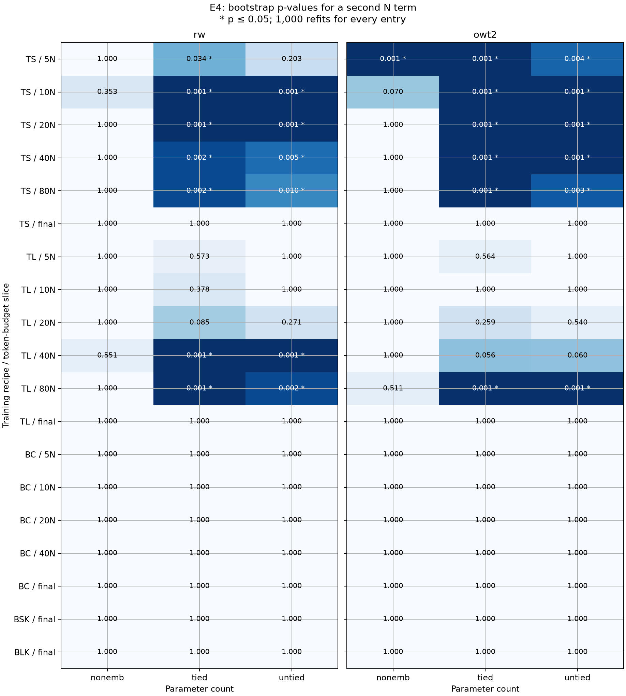
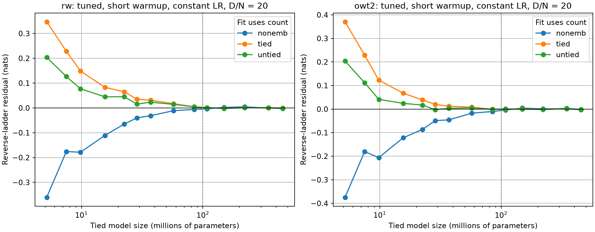

# E4 results (2026-11-26): CONVENTION-DEPENDENT

Date: 2026-11-26. Owner: ub9sc (ultimate brando9 scalable coworker).

**Dark-matter question: why do the tiniest models live off the scaling curve, and what correction brings them back?** The two-term law is one candidate. E4 asks whether a second N term is detected under every Porian training convention and parameter count.

**Preregistered verdict: CONVENTION-DEPENDENT.** A second term is detected in 26/114 tests (22.8%). nonemb: 1/38 (2.6%), NO; tied: 13/38 (34.2%), MIXED; untied: 12/38 (31.6%), MIXED. None reaches the preregistered YES threshold of two thirds. The overall rule therefore supports convention dependence, not a universal correction or absence under all counts.

All detections are in tuned constant-learning-rate, fixed-D/N slices: 26/72 tuned constant tests versus 0/42 base decayed tests; 26/84 fixed-D/N tests versus 0/30 final-checkpoint tests. Both datasets have 13/57 detections. By recipe: TS 20/36, TL 6/36, BC 0/30, BSK 0/6, BLK 0/6. Tuning and schedule are not crossed in the available runs, so these counts do not separate their causal effects.

Only 4/114 tests both detect and have the preregistered POSITIVE reverse-ladder signature: TS at D/N = 20, rw and owt2, tied and untied counts (2 per count; 0 nonemb). Among the other 22 detections, 8 have FLAT signatures and 14 lack four reference sizes. A reverse ladder is unavailable in 30/114 tests (10 per count). Detection alone is not evidence of the preregistered small-end excess-loss signature.

rw: T = 34.338677, p = 0.000999, ΔBIC = 29.061, RMSE 0.01668 → 0.00489 nats, 5M reverse residual +0.347285 nats; owt2: T = 35.075864, p = 0.000999, ΔBIC = 29.798, RMSE 0.02328 → 0.00665 nats, 5M reverse residual +0.370665 nats. Under nonemb at the same slices, both T = 0, p = 1 and ΔBIC = −5.278; the 5M residuals are −0.360215 nats (rw) and −0.374477 nats (owt2). Changing the count changes the apparent correction.

## What ran and what was checked

Original preregistration and fits: Claude Code, Opus 5.5 (claude-opus-5-5), CPU on skampere1. Resume, implementation verification and reports: Codex CLI, GPT-6 Astra ultra, Vals plan; fits are Python computations on skampere1 CPU, not an LLM numerical judgment. No paid API or GPU run. Lean checking and differential testing (DT) are not applicable to these statistical fits. Package versions and input/import SHA-256 hashes are in [run_environment.json](results/run_environment.json). The run used nice priority 10, three worker processes and one BLAS/OpenMP thread per worker.

The [PREREG](PREREG.md) was committed alone before fitting (d690c90). It is unchanged. [verify.py](verify.py) passes the reproduction, counts, full-grid integrity, positive control and null control checks. The 14 finite TS 20N losses equal DM-2 exactly; all six T statistics match E1 within the preregistered relative tolerance, and all six detection decisions agree. Tied 5M residuals agree with DM-2 within 0.005 nats. E1 used B = 200 and E4 uses B = 1,000, so their numerical p-values need not be equal. [Reproduction numbers](results/reproduction.csv), [verification log](results/verify.log).

Controls use 40 synthetic ladders each, the rw TS 20N tied-count 1-term fit, independent 0.005-nat Gaussian noise per size, and 1,000 null-bootstrap refits per ladder. Null: 0/40 false detections (rule ≤6/40). Positive: 40/40 detections (rule ≥32/40) after planting a fast term with exponent 1.4 and +0.3 nats at the actual smallest tied size (5,173,248 parameters). [All control results](results/controls.csv). These controls check this design and noise model; they do not establish universal calibration for misspecified real-data curves.

Resume corrections: the initial snapshot had all 114 result rows but had analytically returned p = 1 for 74 T = 0 rows without executing their claimed 1,000 refits. The resumed run completed all 74,000 missing refits, retaining 40,000 completed positive-T refits only after rechecking observed RSS. All 114 tests now have 1,000 actual refits, with zero nonfinite refits; p-values and detections are unchanged. Each bootstrap saves progress every 100 refits. Cache records now bind the data, seed, bootstrap size and fitter code to a SHA-256 key and record completed refits. The original [run log](results/e4_run.log) is retained beside the [resume log](results/e4_resume.log).

Two draft verifier assertions initially failed because the DM-2 table includes two missing-loss rows and the E1 table repeats c = 2 as c_std. The verifier now selects finite DM-2 losses and the canonical E1 at = c row; no data or statistical rule changed. [Initial assertion logs](results/verify_initial_failure.log).

## Data, method and limits

The loader returns 975 Porian runs (the job brief said 977). A convention is dataset × recipe × slice: 19 per dataset, 38 total, evaluated under three counts. Every test has more than six sizes. TS = tuned/short-warmup/constant; TL = tuned/long-warmup/constant; BC = base/short-warmup/cosine decay; BSK and BLK = base/short- or long-warmup/Kaplan decay. For TS/TL, D/N is 5, 10, 20, 40 or 80, plus final; BC has 5, 10, 20 or 40, plus final; BSK/BLK use final only. Constant-rate checkpoints and cosine final losses are interpolated as preregistered, without extrapolation. D/N always uses the tied count, so counts share losses and checkpoints.

Counts are nonemb = N_nonemb; tied = N_nonemb + Vw (DM-2's N_total); untied = N_nonemb + 2Vw, with V = 50,432. The 5M/7M/9M/15M labels denote the same architectures under every count, indexed by widths 96/128/160/224; they are approximate tied sizes, not the numerical count used for every fit.

The N-only laws are $L=E+A n^{-\alpha}$ and $L=E+A n^{-\alpha}+B n^{-\beta}$ with $n=N/10^6$, $E,A,B\ge0$, and $\alpha>\beta$: alpha is the fast term. Fitting imports DM-1b unchanged through E1/E2; the imported DM-5 copies are byte-identical to dm1_power_analysis. The null bootstrap uses $T=m\log(\mathrm{RSS}_1/\mathrm{RSS}_2)$ and Gaussian noise variance $\mathrm{RSS}_1/(m-3)$, where m is the number of sizes. All B = 1,000 refits run; $p=(1+k)/1001$, and detection requires $p\le0.05$. The inherited numerical comparison tolerance is $10^{-9}\max(T,1)$. ΔBIC = BIC1 − BIC2 uses 3 versus 5 coefficients; positive favors two terms. RMSE = sqrt(RSS/m), in nats. These are N-only comparisons; any joint law in this project remains additive Chinchilla $E+A/N^\alpha+B/D^\beta$.

Reverse-ladder residual = observed loss minus the 1-term prediction fitted on present sizes with tied N ≥ 100M (at least four required). POSITIVE requires the 5M residual >0, at least 75% of sizes below 100M positive, and their mean >+0.02 nats; NEGATIVE is the mirror; otherwise FLAT. The reverse-ladder signature is a companion result and does not alter detection. Tests overlap across counts and slices, are correlated, and have no familywise multiplicity adjustment; the preregistered aggregation rule determines the verdict. Non-detection does not prove absence of a second term. Interpolated checkpoints and seed-independent Gaussian bootstrap noise are modeling assumptions.

## Figures

Figure 1. Bootstrap p-values for all 114 tests; an asterisk marks detection at p ≤ 0.05. Color is −log10(p), with the finite-bootstrap floor 1/1001. Every plotted axis has a grid.

Figure 2. Reverse-ladder residuals at TS 20N, using the same held-out small architectures under three counts. The horizontal axis is tied size for alignment; fitting uses the count in the legend. Dashed vertical line marks the 100M tied reference threshold. The smallest-size residual changes sign when embeddings are excluded.

## Complete table

All losses and residuals are nats. Every row has B = 1,000 completed refits and zero nonfinite refits. ΔBIC is BIC1 − BIC2. Full precision, separate BIC1/BIC2, T and all reverse residuals: [full_table.csv](results/full_table.csv). Fitted coefficients and cache metadata: [e4_cells.csv](results/e4_cells.csv). n/a means fewer than four reference sizes.

| Dataset | Recipe | D/N slice | Count | n | RMSE1 | RMSE2 | ΔBIC | p | Detect | 5M | 7M | 9M | 15M | Small mean | Positive fraction | Reverse signature |
|---|---|---|---|---|---|---|---|---|---|---|---|---|---|---|---|---|
| rw | TS | 5 | nonemb | 13 | 0.0184 | 0.0184 | -5.130 | 1.000000 | no | n/a | n/a | n/a | -0.1313 | -0.0586 | 0.000 | FLAT |
| rw | TS | 5 | tied | 13 | 0.0074 | 0.0057 | 1.502 | 0.033966 | yes | n/a | n/a | n/a | 0.0483 | 0.0152 | 0.833 | FLAT |
| rw | TS | 5 | untied | 13 | 0.0077 | 0.0072 | -3.530 | 0.202797 | no | n/a | n/a | n/a | 0.0361 | 0.0141 | 0.667 | FLAT |
| rw | TS | 10 | nonemb | 14 | 0.0229 | 0.0228 | -5.244 | 0.352647 | no | n/a | -0.1742 | -0.2070 | -0.1408 | -0.0902 | 0.000 | FLAT |
| rw | TS | 10 | tied | 14 | 0.0195 | 0.0041 | 38.606 | 0.000999 | yes | n/a | 0.1403 | 0.0458 | -0.0009 | 0.0228 | 0.500 | FLAT |
| rw | TS | 10 | untied | 14 | 0.0149 | 0.0062 | 19.294 | 0.000999 | yes | n/a | 0.0406 | -0.0204 | -0.0332 | -0.0063 | 0.250 | FLAT |
| rw | TS | 20 | nonemb | 14 | 0.0327 | 0.0327 | -5.278 | 1.000000 | no | -0.3602 | -0.1758 | -0.1785 | -0.1108 | -0.1088 | 0.000 | NEGATIVE |
| rw | TS | 20 | tied | 14 | 0.0167 | 0.0049 | 29.061 | 0.000999 | yes | 0.3473 | 0.2284 | 0.1488 | 0.0832 | 0.1068 | 1.000 | POSITIVE |
| rw | TS | 20 | untied | 14 | 0.0118 | 0.0055 | 16.180 | 0.000999 | yes | 0.2038 | 0.1265 | 0.0774 | 0.0447 | 0.0617 | 1.000 | POSITIVE |
| rw | TS | 40 | nonemb | 12 | 0.0246 | 0.0246 | -4.970 | 1.000000 | no | n/a | n/a | n/a | n/a | n/a | n/a | n/a |
| rw | TS | 40 | tied | 12 | 0.0143 | 0.0059 | 16.061 | 0.001998 | yes | n/a | n/a | n/a | n/a | n/a | n/a | n/a |
| rw | TS | 40 | untied | 12 | 0.0114 | 0.0061 | 9.859 | 0.004995 | yes | n/a | n/a | n/a | n/a | n/a | n/a | n/a |
| rw | TS | 80 | nonemb | 12 | 0.0244 | 0.0244 | -4.970 | 1.000000 | no | n/a | n/a | n/a | n/a | n/a | n/a | n/a |
| rw | TS | 80 | tied | 12 | 0.0135 | 0.0070 | 10.820 | 0.001998 | yes | n/a | n/a | n/a | n/a | n/a | n/a | n/a |
| rw | TS | 80 | untied | 12 | 0.0107 | 0.0069 | 5.474 | 0.009990 | yes | n/a | n/a | n/a | n/a | n/a | n/a | n/a |
| rw | TS | final | nonemb | 16 | 0.0455 | 0.0455 | -5.545 | 1.000000 | no | -298.4577 | -66.7907 | -34.2837 | -10.0958 | -46.3840 | 0.000 | NEGATIVE |
| rw | TS | final | tied | 16 | 0.0299 | 0.0299 | -5.545 | 1.000000 | no | -33.2008 | -17.8419 | -11.3190 | -4.9909 | -8.0677 | 0.000 | NEGATIVE |
| rw | TS | final | untied | 16 | 0.0324 | 0.0324 | -5.545 | 1.000000 | no | -34.1591 | -17.9510 | -11.0093 | -4.7518 | -8.0981 | 0.000 | NEGATIVE |
| rw | TL | 5 | nonemb | 13 | 0.0437 | 0.0437 | -5.130 | 1.000000 | no | n/a | n/a | n/a | 0.2439 | 0.1442 | 0.833 | FLAT |
| rw | TL | 5 | tied | 13 | 0.0336 | 0.0336 | -5.125 | 0.573427 | no | n/a | n/a | n/a | 0.5095 | 0.2448 | 0.833 | FLAT |
| rw | TL | 5 | untied | 13 | 0.0343 | 0.0343 | -5.130 | 1.000000 | no | n/a | n/a | n/a | 0.4973 | 0.2460 | 0.833 | FLAT |
| rw | TL | 10 | nonemb | 14 | 0.0332 | 0.0332 | -5.278 | 1.000000 | no | n/a | -0.7366 | -0.5198 | -0.2242 | -0.2701 | 0.000 | FLAT |
| rw | TL | 10 | tied | 14 | 0.0362 | 0.0356 | -4.815 | 0.377622 | no | n/a | -0.0490 | -0.0086 | 0.0136 | -0.0594 | 0.125 | FLAT |
| rw | TL | 10 | untied | 14 | 0.0394 | 0.0394 | -5.278 | 1.000000 | no | n/a | -0.2313 | -0.1197 | -0.0336 | -0.1073 | 0.000 | FLAT |
| rw | TL | 20 | nonemb | 14 | 0.0481 | 0.0481 | -5.278 | 1.000000 | no | -0.2345 | 0.0399 | 0.0203 | -0.0564 | -0.0380 | 0.333 | FLAT |
| rw | TL | 20 | tied | 14 | 0.0314 | 0.0271 | -1.227 | 0.084915 | no | 0.4155 | 0.3143 | 0.2330 | 0.0424 | 0.1097 | 0.556 | FLAT |
| rw | TL | 20 | untied | 14 | 0.0281 | 0.0269 | -4.054 | 0.270729 | no | 0.1768 | 0.1528 | 0.1251 | -0.0117 | 0.0399 | 0.444 | FLAT |
| rw | TL | 40 | nonemb | 12 | 0.0128 | 0.0128 | -4.966 | 0.551449 | no | n/a | n/a | n/a | n/a | n/a | n/a | n/a |
| rw | TL | 40 | tied | 12 | 0.0290 | 0.0054 | 35.534 | 0.000999 | yes | n/a | n/a | n/a | n/a | n/a | n/a | n/a |
| rw | TL | 40 | untied | 12 | 0.0256 | 0.0065 | 27.949 | 0.000999 | yes | n/a | n/a | n/a | n/a | n/a | n/a | n/a |
| rw | TL | 80 | nonemb | 12 | 0.0084 | 0.0084 | -4.970 | 1.000000 | no | n/a | n/a | n/a | n/a | n/a | n/a | n/a |
| rw | TL | 80 | tied | 12 | 0.0244 | 0.0070 | 25.044 | 0.000999 | yes | n/a | n/a | n/a | n/a | n/a | n/a | n/a |
| rw | TL | 80 | untied | 12 | 0.0223 | 0.0088 | 17.251 | 0.001998 | yes | n/a | n/a | n/a | n/a | n/a | n/a | n/a |
| rw | TL | final | nonemb | 16 | 0.0466 | 0.0466 | -5.545 | 1.000000 | no | -389.3475 | -82.9228 | -41.6816 | -11.8694 | -59.4204 | 0.000 | NEGATIVE |
| rw | TL | final | tied | 16 | 0.0307 | 0.0307 | -5.545 | 1.000000 | no | -40.1110 | -21.1919 | -13.2905 | -5.7676 | -9.5939 | 0.000 | NEGATIVE |
| rw | TL | final | untied | 16 | 0.0328 | 0.0328 | -5.545 | 1.000000 | no | -41.1324 | -21.2507 | -12.8803 | -5.4751 | -9.6039 | 0.000 | NEGATIVE |
| rw | BC | 5 | nonemb | 16 | 0.2688 | 0.2688 | -5.545 | 1.000000 | no | -2.3203 | -0.8675 | -0.4203 | 0.2085 | -0.2241 | 0.667 | FLAT |
| rw | BC | 5 | tied | 16 | 0.1598 | 0.1598 | -5.545 | 1.000000 | no | 0.1234 | 0.2445 | 0.4037 | 0.6077 | 0.3587 | 1.000 | POSITIVE |
| rw | BC | 5 | untied | 16 | 0.1742 | 0.1742 | -5.545 | 1.000000 | no | -0.0570 | 0.1417 | 0.3591 | 0.6058 | 0.3266 | 0.889 | FLAT |
| rw | BC | 10 | nonemb | 15 | 0.1814 | 0.1814 | -5.416 | 1.000000 | no | -0.4548 | 0.2042 | 0.4020 | 0.5184 | 0.1944 | 0.889 | FLAT |
| rw | BC | 10 | tied | 15 | 0.1130 | 0.1130 | -5.416 | 1.000000 | no | 0.7748 | 0.7494 | 0.8143 | 0.7154 | 0.4831 | 1.000 | POSITIVE |
| rw | BC | 10 | untied | 15 | 0.1255 | 0.1255 | -5.416 | 1.000000 | no | 0.5360 | 0.5947 | 0.7189 | 0.6743 | 0.4201 | 1.000 | POSITIVE |
| rw | BC | 20 | nonemb | 14 | 0.1092 | 0.1092 | -5.278 | 1.000000 | no | 0.6484 | 0.7531 | 0.7198 | 0.5273 | 0.3601 | 1.000 | POSITIVE |
| rw | BC | 20 | tied | 14 | 0.0672 | 0.0672 | -5.278 | 1.000000 | no | 1.1869 | 0.9880 | 0.9060 | 0.6176 | 0.4871 | 1.000 | POSITIVE |
| rw | BC | 20 | untied | 14 | 0.0762 | 0.0762 | -5.278 | 1.000000 | no | 0.9722 | 0.8406 | 0.8061 | 0.5665 | 0.4231 | 1.000 | POSITIVE |
| rw | BC | 40 | nonemb | 12 | 0.0711 | 0.0711 | -4.970 | 1.000000 | no | n/a | n/a | n/a | n/a | n/a | n/a | n/a |
| rw | BC | 40 | tied | 12 | 0.0391 | 0.0391 | -4.970 | 1.000000 | no | n/a | n/a | n/a | n/a | n/a | n/a | n/a |
| rw | BC | 40 | untied | 12 | 0.0428 | 0.0428 | -4.970 | 1.000000 | no | n/a | n/a | n/a | n/a | n/a | n/a | n/a |
| rw | BC | final | nonemb | 16 | 0.0698 | 0.0698 | -5.545 | 1.000000 | no | -1659.7648 | -265.1484 | -117.8154 | -27.0919 | -231.8574 | 0.000 | NEGATIVE |
| rw | BC | final | tied | 16 | 0.0415 | 0.0415 | -5.545 | 1.000000 | no | -116.3875 | -54.9524 | -31.9550 | -12.1381 | -25.1529 | 0.000 | NEGATIVE |
| rw | BC | final | untied | 16 | 0.0426 | 0.0426 | -5.545 | 1.000000 | no | -122.7468 | -56.3381 | -31.4510 | -11.6522 | -25.8579 | 0.000 | NEGATIVE |
| rw | BSK | final | nonemb | 16 | 0.0483 | 0.0483 | -5.545 | 1.000000 | no | -74.5689 | -21.0196 | -11.8763 | -4.0427 | -12.7619 | 0.000 | NEGATIVE |
| rw | BSK | final | tied | 16 | 0.0313 | 0.0313 | -5.545 | 1.000000 | no | -11.3880 | -6.5771 | -4.3893 | -2.0628 | -2.9535 | 0.000 | NEGATIVE |
| rw | BSK | final | untied | 16 | 0.0350 | 0.0350 | -5.545 | 1.000000 | no | -11.7133 | -6.6244 | -4.2785 | -1.9616 | -2.9574 | 0.000 | NEGATIVE |
| rw | BLK | final | nonemb | 16 | 0.0507 | 0.0507 | -5.545 | 1.000000 | no | -148.5500 | -36.8891 | -19.7435 | -6.1981 | -24.0313 | 0.000 | NEGATIVE |
| rw | BLK | final | tied | 16 | 0.0325 | 0.0325 | -5.545 | 1.000000 | no | -19.2114 | -10.6504 | -6.8790 | -3.1145 | -4.7875 | 0.000 | NEGATIVE |
| rw | BLK | final | untied | 16 | 0.0367 | 0.0367 | -5.545 | 1.000000 | no | -19.8640 | -10.7701 | -6.7250 | -2.9742 | -4.8230 | 0.000 | NEGATIVE |
| owt2 | TS | 5 | nonemb | 13 | 0.0121 | 0.0075 | 7.572 | 0.000999 | yes | n/a | n/a | n/a | -0.0317 | -0.0371 | 0.000 | FLAT |
| owt2 | TS | 5 | tied | 13 | 0.0214 | 0.0083 | 19.654 | 0.000999 | yes | n/a | n/a | n/a | 0.1457 | 0.0314 | 0.500 | FLAT |
| owt2 | TS | 5 | untied | 13 | 0.0204 | 0.0104 | 12.333 | 0.003996 | yes | n/a | n/a | n/a | 0.1339 | 0.0310 | 0.667 | FLAT |
| owt2 | TS | 10 | nonemb | 14 | 0.0173 | 0.0160 | -3.097 | 0.069930 | no | n/a | -0.1932 | -0.2157 | -0.1471 | -0.1022 | 0.000 | FLAT |
| owt2 | TS | 10 | tied | 14 | 0.0213 | 0.0034 | 46.119 | 0.000999 | yes | n/a | 0.0992 | 0.0148 | -0.0312 | -0.0058 | 0.250 | FLAT |
| owt2 | TS | 10 | untied | 14 | 0.0150 | 0.0042 | 30.295 | 0.000999 | yes | n/a | -0.0189 | -0.0620 | -0.0674 | -0.0394 | 0.000 | FLAT |
| owt2 | TS | 20 | nonemb | 14 | 0.0296 | 0.0296 | -5.278 | 1.000000 | no | -0.3745 | -0.1803 | -0.2059 | -0.1217 | -0.1212 | 0.000 | NEGATIVE |
| owt2 | TS | 20 | tied | 14 | 0.0233 | 0.0067 | 29.798 | 0.000999 | yes | 0.3707 | 0.2289 | 0.1228 | 0.0675 | 0.0964 | 0.889 | POSITIVE |
| owt2 | TS | 20 | untied | 14 | 0.0174 | 0.0063 | 23.180 | 0.000999 | yes | 0.2043 | 0.1118 | 0.0414 | 0.0242 | 0.0449 | 0.778 | POSITIVE |
| owt2 | TS | 40 | nonemb | 12 | 0.0224 | 0.0224 | -4.970 | 1.000000 | no | n/a | n/a | n/a | n/a | n/a | n/a | n/a |
| owt2 | TS | 40 | tied | 12 | 0.0195 | 0.0052 | 26.557 | 0.000999 | yes | n/a | n/a | n/a | n/a | n/a | n/a | n/a |
| owt2 | TS | 40 | untied | 12 | 0.0163 | 0.0053 | 21.968 | 0.000999 | yes | n/a | n/a | n/a | n/a | n/a | n/a | n/a |
| owt2 | TS | 80 | nonemb | 12 | 0.0284 | 0.0284 | -4.970 | 1.000000 | no | n/a | n/a | n/a | n/a | n/a | n/a | n/a |
| owt2 | TS | 80 | tied | 12 | 0.0096 | 0.0030 | 22.885 | 0.000999 | yes | n/a | n/a | n/a | n/a | n/a | n/a | n/a |
| owt2 | TS | 80 | untied | 12 | 0.0063 | 0.0032 | 11.352 | 0.002997 | yes | n/a | n/a | n/a | n/a | n/a | n/a | n/a |
| owt2 | TS | final | nonemb | 16 | 0.0543 | 0.0543 | -5.545 | 1.000000 | no | -313.9351 | -69.2348 | -35.2922 | -10.2492 | -48.5003 | 0.000 | NEGATIVE |
| owt2 | TS | final | tied | 16 | 0.0331 | 0.0331 | -5.545 | 1.000000 | no | -34.1398 | -18.2038 | -11.4797 | -5.0047 | -8.2224 | 0.000 | NEGATIVE |
| owt2 | TS | final | untied | 16 | 0.0371 | 0.0371 | -5.545 | 1.000000 | no | -35.1169 | -18.3088 | -11.1572 | -4.7592 | -8.2518 | 0.000 | NEGATIVE |
| owt2 | TL | 5 | nonemb | 10 | 0.0290 | 0.0290 | -4.605 | 1.000000 | no | n/a | n/a | n/a | 0.2487 | 0.1686 | 0.667 | FLAT |
| owt2 | TL | 5 | tied | 10 | 0.0274 | 0.0274 | -4.585 | 0.564436 | no | n/a | n/a | n/a | 0.5181 | 0.3170 | 1.000 | FLAT |
| owt2 | TL | 5 | untied | 10 | 0.0309 | 0.0309 | -4.605 | 1.000000 | no | n/a | n/a | n/a | 0.5039 | 0.3153 | 1.000 | FLAT |
| owt2 | TL | 10 | nonemb | 11 | 0.0232 | 0.0232 | -4.796 | 1.000000 | no | n/a | -1.0979 | -0.8224 | -0.4158 | -0.5316 | 0.000 | FLAT |
| owt2 | TL | 10 | tied | 11 | 0.0138 | 0.0138 | -4.796 | 1.000000 | no | n/a | -0.2789 | -0.2199 | -0.1407 | -0.1604 | 0.000 | FLAT |
| owt2 | TL | 10 | untied | 11 | 0.0200 | 0.0200 | -4.796 | 1.000000 | no | n/a | -0.4885 | -0.3468 | -0.1942 | -0.2419 | 0.000 | FLAT |
| owt2 | TL | 20 | nonemb | 11 | 0.0607 | 0.0607 | -4.796 | 1.000000 | no | -0.8842 | -0.3376 | -0.2415 | -0.2117 | -0.3090 | 0.000 | NEGATIVE |
| owt2 | TL | 20 | tied | 11 | 0.0346 | 0.0326 | -3.495 | 0.258741 | no | 0.0476 | 0.0473 | 0.0492 | -0.0813 | -0.0067 | 0.500 | FLAT |
| owt2 | TL | 20 | untied | 11 | 0.0314 | 0.0313 | -4.710 | 0.540460 | no | -0.2509 | -0.1513 | -0.0814 | -0.1454 | -0.1271 | 0.000 | NEGATIVE |
| owt2 | TL | 40 | nonemb | 9 | 0.0329 | 0.0329 | -4.394 | 1.000000 | no | n/a | n/a | n/a | n/a | n/a | n/a | n/a |
| owt2 | TL | 40 | tied | 9 | 0.0207 | 0.0135 | 3.334 | 0.055944 | no | n/a | n/a | n/a | n/a | n/a | n/a | n/a |
| owt2 | TL | 40 | untied | 9 | 0.0162 | 0.0112 | 2.267 | 0.059940 | no | n/a | n/a | n/a | n/a | n/a | n/a | n/a |
| owt2 | TL | 80 | nonemb | 9 | 0.0051 | 0.0051 | -4.386 | 0.511489 | no | n/a | n/a | n/a | n/a | n/a | n/a | n/a |
| owt2 | TL | 80 | tied | 9 | 0.0282 | 0.0054 | 25.283 | 0.000999 | yes | n/a | n/a | n/a | n/a | n/a | n/a | n/a |
| owt2 | TL | 80 | untied | 9 | 0.0264 | 0.0059 | 22.459 | 0.000999 | yes | n/a | n/a | n/a | n/a | n/a | n/a | n/a |
| owt2 | TL | final | nonemb | 13 | 0.0574 | 0.0574 | -5.130 | 1.000000 | no | -408.2640 | -85.9915 | -42.9976 | -12.1120 | -92.3867 | 0.000 | NEGATIVE |
| owt2 | TL | final | tied | 13 | 0.0324 | 0.0324 | -5.130 | 1.000000 | no | -41.3744 | -21.7288 | -13.5653 | -5.8331 | -14.2397 | 0.000 | NEGATIVE |
| owt2 | TL | final | untied | 13 | 0.0366 | 0.0366 | -5.130 | 1.000000 | no | -42.4674 | -21.8042 | -13.1497 | -5.5357 | -14.2842 | 0.000 | NEGATIVE |
| owt2 | BC | 5 | nonemb | 16 | 0.2698 | 0.2698 | -5.545 | 1.000000 | no | -1.8074 | -0.4486 | -0.1391 | 0.3756 | -0.0480 | 0.667 | FLAT |
| owt2 | BC | 5 | tied | 16 | 0.1449 | 0.1449 | -5.545 | 1.000000 | no | 0.4999 | 0.6112 | 0.6507 | 0.7619 | 0.5076 | 1.000 | POSITIVE |
| owt2 | BC | 5 | untied | 16 | 0.1607 | 0.1607 | -5.545 | 1.000000 | no | 0.3225 | 0.5092 | 0.6056 | 0.7592 | 0.4757 | 1.000 | POSITIVE |
| owt2 | BC | 10 | nonemb | 15 | 0.1786 | 0.1786 | -5.416 | 1.000000 | no | 0.2394 | 0.6042 | 0.6885 | 0.6933 | 0.3983 | 1.000 | POSITIVE |
| owt2 | BC | 10 | tied | 15 | 0.1061 | 0.1061 | -5.416 | 1.000000 | no | 1.2382 | 1.0554 | 1.0356 | 0.8632 | 0.6380 | 1.000 | POSITIVE |
| owt2 | BC | 10 | untied | 15 | 0.1187 | 0.1187 | -5.416 | 1.000000 | no | 1.0184 | 0.9107 | 0.9446 | 0.8227 | 0.5786 | 1.000 | POSITIVE |
| owt2 | BC | 20 | nonemb | 14 | 0.1069 | 0.1069 | -5.278 | 1.000000 | no | 0.6410 | 0.7405 | 0.6947 | 0.5227 | 0.3618 | 0.889 | POSITIVE |
| owt2 | BC | 20 | tied | 14 | 0.0602 | 0.0602 | -5.278 | 1.000000 | no | 1.2430 | 1.0057 | 0.9036 | 0.6244 | 0.5047 | 0.889 | POSITIVE |
| owt2 | BC | 20 | untied | 14 | 0.0697 | 0.0697 | -5.278 | 1.000000 | no | 1.0171 | 0.8511 | 0.7991 | 0.5711 | 0.4375 | 0.889 | POSITIVE |
| owt2 | BC | 40 | nonemb | 12 | 0.0769 | 0.0769 | -4.970 | 1.000000 | no | n/a | n/a | n/a | n/a | n/a | n/a | n/a |
| owt2 | BC | 40 | tied | 12 | 0.0422 | 0.0422 | -4.970 | 1.000000 | no | n/a | n/a | n/a | n/a | n/a | n/a | n/a |
| owt2 | BC | 40 | untied | 12 | 0.0470 | 0.0470 | -4.970 | 1.000000 | no | n/a | n/a | n/a | n/a | n/a | n/a | n/a |
| owt2 | BC | final | nonemb | 16 | 0.0812 | 0.0812 | -5.545 | 1.000000 | no | -1640.8287 | -263.7399 | -117.4047 | -27.1292 | -229.5671 | 0.000 | NEGATIVE |
| owt2 | BC | final | tied | 16 | 0.0394 | 0.0394 | -5.545 | 1.000000 | no | -116.4061 | -55.0283 | -31.9463 | -12.1883 | -25.1784 | 0.000 | NEGATIVE |
| owt2 | BC | final | untied | 16 | 0.0444 | 0.0444 | -5.545 | 1.000000 | no | -122.9493 | -56.4950 | -31.4828 | -11.7131 | -25.9192 | 0.000 | NEGATIVE |
| owt2 | BSK | final | nonemb | 16 | 0.0447 | 0.0447 | -5.545 | 1.000000 | no | -75.2756 | -21.1955 | -11.9682 | -4.0659 | -12.9092 | 0.000 | NEGATIVE |
| owt2 | BSK | final | tied | 16 | 0.0218 | 0.0218 | -5.545 | 1.000000 | no | -11.3820 | -6.5821 | -4.3915 | -2.0604 | -2.9879 | 0.000 | NEGATIVE |
| owt2 | BSK | final | untied | 16 | 0.0255 | 0.0255 | -5.545 | 1.000000 | no | -11.6760 | -6.6125 | -4.2696 | -1.9542 | -2.9840 | 0.000 | NEGATIVE |
| owt2 | BLK | final | nonemb | 16 | 0.0492 | 0.0492 | -5.545 | 1.000000 | no | -214.3732 | -49.5478 | -25.7379 | -7.6941 | -33.7321 | 0.000 | NEGATIVE |
| owt2 | BLK | final | tied | 16 | 0.0261 | 0.0261 | -5.545 | 1.000000 | no | -24.9812 | -13.5214 | -8.5951 | -3.7915 | -6.1239 | 0.000 | NEGATIVE |
| owt2 | BLK | final | untied | 16 | 0.0297 | 0.0297 | -5.545 | 1.000000 | no | -25.8146 | -13.6580 | -8.3875 | -3.6156 | -6.1682 | 0.000 | NEGATIVE |

TLDR-end: [dark-matter: E4] The second N term is convention-dependent (26/114 detections); only four detections have the preregistered positive small-end reverse-ladder signature. All 114,000 grid refits and 80,000 control refits are complete, and verification passes.
