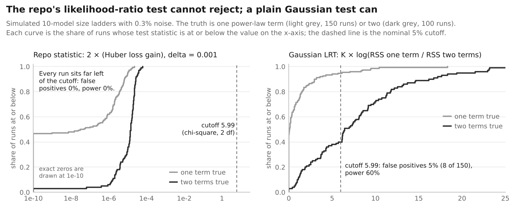
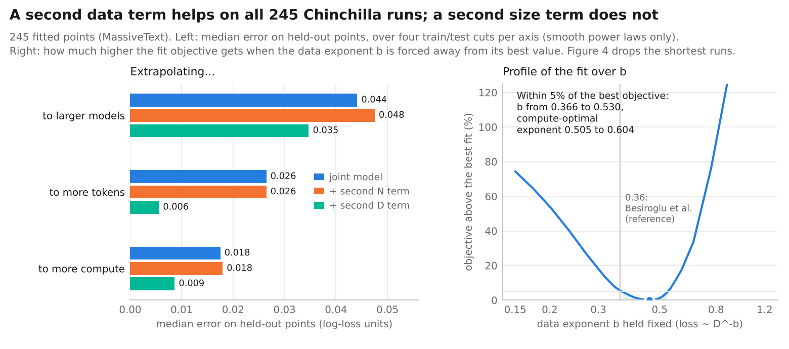
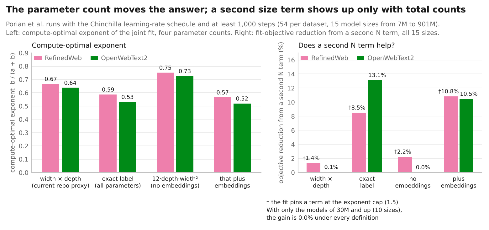
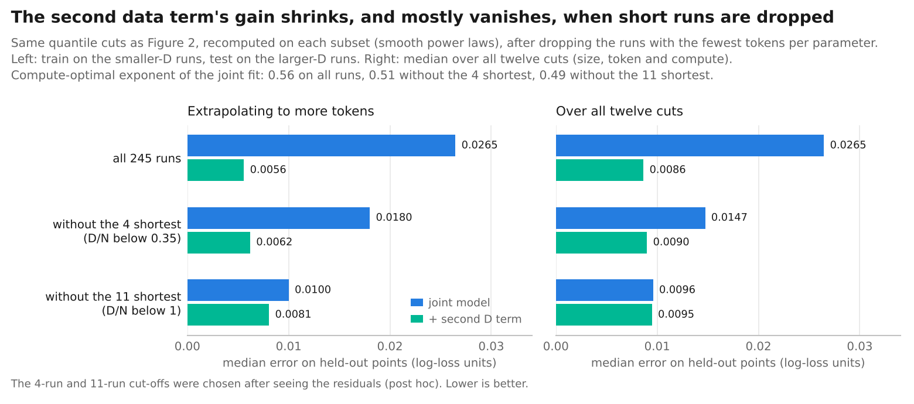

# Is there dark matter in the scaling law?

## Answer

I found no evidence that a second, shallower power law in model size is a real feature of these data, but I cannot rule one out either: the likelihood-ratio test the repo ships cannot reject anything, and a test calibrated by simulation is weak on ladders of seven to ten models. Three results change what I would do next.

First, the repo's test is off by more than four orders of magnitude, so its p-value of one carries no information (items 2 to 4 and 11). Second, on the Chinchilla points the fit switches a second size term off, and a second data term looks impressive on all two hundred and forty-five runs, but it shrinks when the shortest runs are dropped and mostly disappears only when every run under one token per parameter is dropped, a cut I chose after seeing the residuals. Four runs trained on under a third of a token per parameter carry ninety percent of the joint fit's squared error. Without them the benefit on token extrapolation falls from about four fifths to about two thirds, and without all eleven runs under one token per parameter it falls to about one fifth, with almost nothing left on the size and compute axes; measured against the repo's own single-start fit, which forecasts better than my multi-start one on those subsets, the token-axis gains are about one quarter and about one percent (items 14 to 18 and 35 to 41). Dropping those four runs moves the compute-optimal exponent from zero point five six to zero point five one. Another agent's experiment on main shows the same dominance: three runs under a third of a token per parameter produce ninety-eight percent of its held-out squared error on the Chinchilla runs (item 43). Third, on the Porian grid the way parameters are counted moves the compute-optimal exponent between about zero point five seven and zero point seven five on RefinedWeb and between about zero point five two and zero point seven three on OpenWebText2, and in my slice an apparent second size term lives at the small end, disappearing once the five smallest models are dropped (items 27 to 33). Whether embedding accounting explains it is not settled: another agent's profiled-embedding experiment on main finds the second term still detectable with the embedding weight free, so I do not claim counting alone is the answer.

## Update as of 11-26-2026

Main moved from commit 570e850 to 3626ba0 after I wrote this report. The changes below affect where this folder sits and what else is on main. None of my own numbers changed.

1. Folder number. Folders 14 and 15 are now taken, by ub9sc (Brando's assistant, ultimate brando9 scalable coworker): 14_e2_token_budget_hparams_small_end and 15_e4_porian_lrt_both_counts. This folder is therefore number sixteen, and the advice further down to renumber it to fourteen is withdrawn. The folder name carries its start date, and an end date because this set of experiments has no pending phase.
2. Folder 15 is the experiment my report said was not yet on main: the bootstrap likelihood-ratio test on the Porian grid under three parameter counts. Its verdict is convention dependent. A second size term is detected in twenty-six of one hundred and fourteen tests: one of thirty-eight when embeddings are left out of the count, thirteen of thirty-eight with the tied count and twelve of thirty-eight with the untied count. All twenty-six detections are in tuned, constant-learning-rate slices at a fixed number of tokens per parameter, and only four tests both detect and show the preregistered small-end signature. My E4 points the same way in direction only: in my slice the second size term lowers the fit objective by about ten point eight percent on RefinedWeb and ten point five percent on OpenWebText2 when embeddings are counted, and by about two point two five percent and three hundredths of a percent when they are not (items 32 and 33). Mine is a pilot, with a Huber-gain comparison instead of a calibrated test, on a slice I did not map onto theirs, so it neither replicates nor contradicts their result.
3. Folder 14 is ub9sc's test of whether a token-budget or training-recipe confound explains the small-end misfit. Its author reports it as scientifically unresolved, because the preregistered control gates fail. It is not a test of my finding about the runs under one token per parameter on the Chinchilla points, and I do not read it as one.
4. The embedding ladder (the plan's E5, folder 11) holds only its README on main, with the first phase queued on 11-25-2026. The controlled embedding test has not landed, so the first next step below still stands.
5. Main also has py_src/conjecture_fits.py and py_src/ladders.py. My py_src/scaling_ext.py and py_src/safe_pickle.py stay in py_src because the scripts here import them from there and AGENTS.md puts reusable fitting code in py_src. The overlap of scaling_ext.py with conjecture_fits.py is still open, and comparing the two fitters remains a next step.

## Scope, sources and naming

Four CPU experiments on the two-term conjecture and the Chinchilla fit, plus a robustness check I added after the results came in. Run on 11-25-2026 by Claude Sonnet 5.5 in a Claude Code cloud session, on two CPU cores, with no GPU and no cluster. None of it was preregistered. This version includes the fixes from a four-reviewer QA pass and a fresh re-verification. The update dated 11-26-2026, just above this section, changes only where this folder sits and what else is on main; none of my own numbers changed.

Every number from my own experiments comes from files in results/. Numbers quoted from other agents' work in "Where this sits in the repo" come from their files on main at commit 570e850, and the numbers in the update come from their files at commit 3626ba0. "Item N" points to the numbered list at the end, which report_numbers.py prints from the files in results/; the few values it transcribes from other agents' files are labelled as transcribed in the items.

Naming. In the two-term N-only law, alpha is the fast (larger) exponent and beta the slow one, beta below alpha, as in fit_two_term_N_only and the experiments index. In the joint Chinchilla law, alpha is the size exponent and beta the data exponent, as in the Besiroglu form; the repo's RESULTS.md calls the data term G over D to the gamma. E1 to E4 are this report's own labels and are unrelated to the E1 to E5 of the plan in agent-sync.

## What I ran

1. E1, calibration and power of the two-term test. One hundred and fifty one-term ladders and one hundred two-term ladders at each of two noise levels, zero point three percent and one percent, with ten model sizes from ten million to twelve billion parameters. In the two-term truth the shallow term is nine to seventeen percent of the loss, but a one-term law absorbs most of it: the best one-term fit to the noiseless two-term ladder misses by at most zero point three percent, about the low noise level and a third of the high one, so this is a hard detection problem (item 1). I compared the repo's Huber statistic with a Gaussian one, and forecast the three largest sizes from the seven smallest.
2. E2, the joint law on Chinchilla. The two hundred and forty-five Chinchilla points in the repo's Hitchhiker's Guide data, with forty-three distinct model sizes (item 12). Twelve train-small, test-large splits cut by N, by D and by compute; profiles of both exponents; and full-data fits with and without an extra additive term in N or in D.
3. E3, real fixed-data ladders. Pythia, deduplicated Pythia and OPT at their final checkpoints, with loss taken as the natural log of LAMBADA perplexity (items 22 to 24). A parametric bootstrap for the second term, and thirteen rolling forecasts.
4. E4, the Porian grid. Chinchilla-schedule runs from the Porian et al. dataset, fifty-four per dataset, fifteen sizes from seven million to nine hundred and one million parameters (item 26). Four definitions of N, eight backtests, and a test of whether the second N term survives when the smallest models are dropped, under each definition.
5. E2b, a robustness check added after the results came in. The repo's RESULTS.md says the joint fit's error on the Chinchilla points is four very short runs, and my residuals agree (item 35). I repeated the E2 splits and full-data fits on the two hundred and forty-one runs with D over N of at least zero point three five, and on the two hundred and thirty-four runs with D over N of at least one. Both cut-offs were chosen after seeing the residuals, so this check is labelled post hoc.

I wrote a new fitter for this, py_src/scaling_ext.py. For each draw of the exponents it solves the linear coefficients by non-negative least squares, refines the best draws with a trust-region solver using the same Huber loss as the repo, and warm-starts each larger model from the smaller one, so an extended model can never fit worse than its nested model on the training data. Every extra term is additive in the loss, as AGENTS.md requires; no multiplicative form appears anywhere. On synthetic and real data it matched or beat the repo's single-start fit on the training objective, and five different seeds gave the same optimum on the Chinchilla points (results/validate_scaling_ext.txt).

None of this needed a cluster. The fits are to tables of at most a thousand rows and finished in minutes on two CPU cores. A cluster matters only for new training runs, and the main one is already queued by another agent (see "Where this sits in the repo").

## Findings

1. The repo's likelihood-ratio test cannot reject. On simulated ten-size ladders it never fired at either noise level, and its largest statistic over two hundred and fifty ladders was about ninety-four thousand times below the five percent cutoff at low noise and about forty-three thousand times below it at high noise (item 2). The cause is scale: the test treats the summed Huber loss as a negative log-likelihood with unit scale, but with Huber's delta at a thousandth, a residual larger than that costs only a thousandth of its size, so with noise of a few thousandths to a hundredth almost all of the objective comes from that linear part and the loss differences are at most about a ten-thousandth. The statistic still ranks ladders well, with an area under the curve of zero point nine at low noise, and reaches sixty-six percent power at a threshold calibrated on its own null (item 4); I put no interval on that figure, and it rests on a threshold estimated from only one hundred and fifty null ladders, so it does not rank the repo statistic against the Gaussian one in finding 2. So the idea is workable and the threshold is wrong. The repo's own smoke test fails the same way, and its statistic is even negative, so the one-term baseline fit its points at least as well as the two-term model, with a p-value of one (item 11).

2. A Gaussian version is roughly calibrated at ten sizes in this simulation, but not reliably so, and it is weak. The statistic K times the log of the ratio of residual sums of squares, referred to chi-square with two degrees of freedom, gave false-positive rates of five point three percent and two point seven percent at the two noise levels (eight and four of one hundred and fifty null ladders, so the ninety-five percent intervals run from about three to ten percent and from one to seven percent). Chi-square with two degrees of freedom is not the theoretical reference here, because under the null the second coefficient sits on its zero boundary and the shallow exponent is not identified. The statistic is exactly zero in forty-three and forty-nine percent of the null ladders, and its empirical ninety-fifth percentile is five point nine three at low noise but four point zero seven at one percent noise, so the cutoff of five point nine nine is about right at the first level and conservative at the second. On the seven-size training ladders, which are closer to the real ones, the same reference gives a false-positive rate of ten percent at low noise (interval six to sixteen percent) and two point seven percent at one percent noise (item 5), so real use needs a parametric bootstrap, as in DM-1b. Its power was sixty percent at low noise and eighteen percent at one percent noise, thirty-two percent at the corrected threshold (item 5). Even a good test therefore needs ladders that are longer or quieter than the public ones.

3. The two-term fit is weakly identified, and it hurts forecasts when it is wrong. About four in ten one-term ladders and half of the two-term ladders ended on a boundary (item 6). A common failure sends the irreducible loss to zero and the shallow exponent to nearly zero, which mimics a logarithm. Even when the truth has two terms, the fitted shallow exponent was within zero point zero five of the truth in only eight to eleven percent of ladders (item 7). In a held-out forecast of the three largest sizes at low noise, the two-term model cut the median error by about nineteen percent when it was true (the mean by nine percent, and the bootstrap interval for the median runs from about forty percent lower to about zero), winning fifty-seven ladders and losing twenty-four, and raised both the median and the mean error by about seventy-six percent when it was not. At one percent noise it raised the median error by about twenty-three percent when it was not true, and when it was true it was no better than a coin flip, winning twenty-seven ladders, tying thirty-nine and losing thirty-four (items 8 and 9). Gating on the training-set statistic fires on only ten percent of two-term ladders at low noise and seventeen percent at one percent noise, so it cuts the median forecast error by about six percent at low noise, about three tenths of what always using the two-term model gains, and gains nothing at one percent noise; its threshold comes from simulated one-term ladders at the true noise level, which a real study would not have (item 10).

4. On all two hundred and forty-five Chinchilla points the extra structure looks like it is in D, not N. The multi-start joint fit gives an irreducible loss of one point nine, a size exponent of zero point three five and a data exponent of zero point four six, so the compute-optimal exponent is about zero point five six (item 13). Adding a second N term changes nothing: the fit sets its coefficient to a few times ten to the minus fifteen (item 14). Adding a second D term lowers the Huber objective by thirty-seven and a half percent and the residual sum of squares by sixty-two percent (item 14). It cuts the median held-out error from two point six five percent to zero point five six percent when extrapolating to more tokens, from one point seven five percent to zero point eight six percent to more compute, and from four point four one percent to three point four seven percent to larger models (items 15 to 17), in log-loss units, which read roughly as relative error. It beats the joint fit in eleven of twelve cuts and ties it in the twelfth, at either exponent cap, where the fit switches the extra term off (item 18). The fitted second term has an exponent of about zero point zero four five, the irreducible loss falls to about zero point zero six, and the main data exponent rises to about one (item 14). This is the corner described in finding 3: the irreducible loss nearly vanishes and a term with an exponent of about zero point zero four five, which varies slowly across the observed token range, takes its place, while a steep term near D to the minus one absorbs the shortest run and part of the next three. My boundary flags miss it on the full data because their irreducible-loss threshold is one tenth of one percent of the smallest loss. The four shortest runs carry about thirty-five percent of the joint fit's Huber objective (item 35), but only about half of what the extra term removes comes from them, and under the extended fit they still carry about a quarter of it. Seven of the twelve training fits sit on a boundary (item 19). That is the picture before the next finding.

5. The gain shrinks without the four shortest runs and mostly disappears without the eleven runs under one token per parameter. The four runs with D over N below zero point three five, between zero point zero four and zero point three one tokens per parameter, carry ninety percent of the joint fit's residual sum of squares, with observed loss above the fitted loss by zero point zero eight to zero point two six in log units; the other two hundred and forty-one runs have a root-mean-square residual of zero point zero zero seven five against zero point zero two three seven for all (item 35). Without those four, the joint fit moves to an irreducible loss of one point eight two five, a size exponent of zero point three five and a data exponent of zero point three seven (item 36). The second D term still helps, but less: the Huber objective falls by twenty-two percent instead of thirty-seven and a half, the median held-out error on token extrapolation falls by sixty-six percent instead of seventy-nine, and the median over all twelve cuts by thirty-nine percent instead of sixty-seven; it wins eleven of twelve cuts and ties the other (items 37, 38 and 40). Without all eleven runs under one token per parameter, most of what is left goes too: the objective gain is ten point six percent with the irreducible loss pinned at zero, the token-axis gain is nineteen percent, and the median over all twelve cuts is zero point zero zero nine five against zero point zero zero nine six for the joint fit; it wins five of twelve cuts, ties six and loses one (items 37, 38 and 40). Measured against the repo's single-start joint fit, which forecasts better than my multi-start one on these subsets (finding 6), the token-axis gain is about a quarter without the four shortest runs, zero point zero zero eight four against zero point zero zero six two, and about one percent without the eleven, zero point zero zero eight two against zero point zero zero eight one (item 41), so the gain that survives dropping the eleven runs is about the size of the spread between optimizers. My reading is that on these points much of the second D term's gain comes from fitting the runs trained on fewer tokens than parameters. I tested only that low side, not the runs far above twenty tokens per parameter. Dropping these runs also removes the only large models trained on few tokens, which constrain the shape of the D term most, so this check cannot tell anomalous runs from real curvature that the remaining data cannot resolve. In the token and compute cuts the four shortest runs are always in the training set, and in the size cuts they are always in the test set, so part of the size-axis change on dropping them is the test set losing its four outliers. I did not test why those runs sit above the curve; short training schedules are one candidate. They are large models, between about two point three and six point eight billion parameters, trained on between about two hundred and forty-five million and seven hundred million tokens (item 44), and three of the four fall in the test split of another agent's size-holdout experiment on main, where they produce ninety-eight percent of the held-out squared error (item 43).

6. The compute-optimal exponent is a band, it depends on which runs are kept, and the best optimum is not the best forecaster. On all runs, profiling the objective gives an exponent of about zero point five four to zero point five nine within one percent of the best objective, and zero point five zero to zero point six three within five percent (items 20 and 21; the profile grid is zero point zero one apart near the optimum, so these edges are approximate). But the point estimate itself moves from zero point five six to zero point five one when four runs are dropped and to zero point four nine when eleven are dropped (item 36), so the choice of runs moves the estimate by slightly more than the width of the one percent band, and the eleven-run value sits just below the five percent band. The fit without the four shortest runs lands close to the two-decimal constants in AGENTS.md (irreducible loss one point eight two, size exponent zero point three four, data exponent zero point three six, which imply an exponent of zero point five one); I report that as a reference and did not use those constants as a pass or fail check. The repo's single-start fit has a slightly worse training objective than the multi-start optimum, yet it extrapolated better by more than one percent in five of twelve cuts on all runs (three more were within one percent), in nine of twelve without the four shortest and in seven of twelve without the eleven (item 41). A flat objective means the optimizer's point estimate is not decisive, so report the band and say which runs were kept.

7. Real ladders show no sign of a second term. Bootstrap p-values were zero point five four for Pythia, zero point two one for deduplicated Pythia and zero point six five for OPT (items 22 to 24). For the two Pythia ladders the two-term fit sits in the corner, with irreducible loss near zero and a shallow exponent between zero point zero zero five and zero point zero seven; for OPT the second term is switched off. Of thirteen rolling forecasts, twelve are ties to six decimal places between the one-term and two-term models, and in the thirteenth the two-term model is worse, at zero point four eight percent error against zero point two seven (item 25). These ladders have only seven or eight sizes, and Pythia and deduplicated Pythia differ only in deduplication, so they are closer to two independent ladders than three; this is absence of evidence rather than evidence of absence.

8. On the Porian grid the parameter count moves the compute-optimal exponent a lot. Across four ways of counting N the compute-optimal exponent runs from zero point five seven to zero point seven five on RefinedWeb and from zero point five two to zero point seven three on OpenWebText2 (items 27 and 28). Width times depth, the proxy in chinchilla_verification.py, overstates the exponent by about zero point zero eight and zero point one one against the exact parameter label, lowers the fitted irreducible loss by about zero point four two and zero point four seven nats, and, taken at face value, implies about seven hundred and sixty or about eighteen hundred and forty tokens per parameter at ten to the twenty-first operations, against seven or fourteen with the exact label. The data exponent barely moves, between about zero point four eight and zero point five three, so almost all of the shift is in the size exponent. The direction of the shift holds across all four minimum-step filters I tried, on both datasets (item 29). With the exact label fixed, the minimum-steps filter alone moves the exponent between zero point four nine and zero point five nine on RefinedWeb, a spread about as large as the shift from the proxy at my main filter.

9. On the Porian grid the apparent second N term lives at the small end, and whether parameter counting explains it is not settled. With the exact label it lowers the fit objective by eight and a half percent on RefinedWeb, in a fit that pins an exponent at its upper limit, and by thirteen percent on OpenWebText2, but by nothing at all once the five models below thirty million parameters are dropped (items 30 and 31). It is already small on the full grid when embeddings are left out of the count: two point two percent on RefinedWeb, where, like every RefinedWeb fit here, it is a boundary fit, and none on OpenWebText2 (items 32 and 33). One reading is that at small widths the embedding parameters dominate the total, so loss against total parameters bends. ub9sc's profiled-parameter-count experiment on main (folder 12) is a closer test of that reading than mine, and it does not confirm it: with the embedding weight free the second term is still detectable on both Porian datasets, and the smallest models stay off the one-term curve at every weight in the common range by that experiment's own bootstrap scale, although against Porian's seed-to-seed spread the smallest RefinedWeb model is within noise (see "Where this sits in the repo"). Adding any extra term to my backtests lowers the median held-out error modestly, from one point seven percent to between one point two and one point six percent, but seven or eight of the eight extended fits sit on a boundary, so I read this as flexible curve fitting (item 34).

## Where this sits in the repo

I read the repo's main again just before writing this up (commit 570e850). It already holds related work by other agents, so some of this report confirms it and some of it should not be duplicated. Since my first read (commit 85db67d) it gained experiments 09 and 10 from the cloud agent that wrote 01 to 08, the code and results of ub9sc's profiled-parameter-count experiment (folder 12) and small-to-large forecast (folder 13), both preregistered in 85db67d before any fit, and the workflow rules in section 0 of AGENTS.md (570e850). I read their READMEs and results files and recomputed one number from experiment 09's saved predictions; I did not rerun any of their code. Their labels E1 and E3 are not the same as mine.

1. Agreement on Chinchilla. The other agents' CPU experiments, summarized in experiments/RESULTS.md, also find that a second power of N does not reduce held-out error on the Chinchilla points, that the joint-fit starts agree while bootstrap fits do not, and that the joint fit's error on these points is a few very short runs. My multi-start joint fit reaches a Huber objective of one point eight two eight times ten to the minus three and a size exponent of zero point three five three, which match the one point eight three times ten to the minus three and the zero point three five one to zero point three five three reported there (item 13). I have not re-verified their other numbers.
2. Experiment 09 is a second view of the short-run result. Its joint size-holdout comparison on the Chinchilla runs reports the same test error for the joint law, the law with a second N term and the law with a second D term (a root-mean-square error of zero point two five zero one in loss units), and says the second D power collapses. From its saved predictions I find that three of the four runs with D over N below zero point three five fall in its test split, that they produce ninety-eight percent of the squared error, and that the error without them is about zero point zero three four; the Epoch extraction behaves the same way, with four runs and about ninety-nine percent (item 43). That comparison therefore cannot separate the models, whichever is better. Only one run with D over N below zero point three five is in the Chinchilla training split, and none is in the Epoch training split, which may be why the second D term collapses there; I did not test that. Its pseudo-AIC and pseudo-BIC add twice the Huber objective, which is of order one thousandth, to the parameter count, and its own README says the parameter term dominates unless a new parameter cuts the objective by order one, so those criteria cannot favour an extension on these ladders. That is the same scale problem as lr_test. My fitter, with more starts and non-negative least-squares seeds, finds a second D term that does not collapse on the full data (item 14), and E2b shows that much of its gain comes from the runs under one token per parameter.
3. The calibrated test already exists, and the power question has a second answer on main. DM-1b (experiments/dm1_power_analysis) built a parametric-bootstrap likelihood-ratio test and ran it on forty-three thousand two hundred synthetic ladders, twelve thousand of them null, with a pooled null rejection rate of zero point zero four nine and a worst cell of zero point zero seven; on a ladder from ten million to a billion parameters it did not reach eighty percent power for a fast-term strength of up to zero point three (DM-1 plants the extra term as the fast one, with an exponent two to three times the base exponent, the opposite of my E1, where the extra term is the slow one). Experiment 07 finds that on its designed truth no noisy cell of its grid meets its pre-set rule, an eighty percent held-out win rate and a median gain of at least one hundredth of a nat (the rule is a constant in run_power.py and, its README says, was not changed after seeing the grid); its best cell, at half a percent noise with sixty-four sizes over a range of ten thousand, wins sixteen of sixteen but by only about zero point zero zero six six nats. Both agree in direction with my low-power results (items 4, 5 and 8), though they measure different quantities. The library function lr_test in py_src/scaling_laws_fit.py is unchanged on main, so the fix is to port DM-1b's test, not to write a new one.
4. The embedding question has several tests on main, and none confirms it. DM-2 found that on the Porian rw and owt2 curves at twenty tokens per parameter a second term is significant when embeddings count fully and absent when they do not, and DM-3 could not pin the embedding weight because the embedding parameters move in lockstep with width along one ladder, and it concluded that embedding accounting is rejected as the whole story. ub9sc's profiled-parameter-count experiment (folder 12) is the closest test. A shared embedding weight passes its preregistered rule only weakly, with a common ninety-five percent range of two point two one to two point six six embedding-block units. With the weight free, the second term is still detectable on both Porian datasets (bootstrap p of zero point zero zero five, the smallest that two hundred replicates allow). At no weight in the common range do the smallest models of all four ladders return within two bootstrap standard deviations of the curve, and at zero weight the smallest Porian model sits below the curve, so the excess changes sign instead of vanishing. Its verdict is that counting alone does not bring the tiny Porian models back onto one power law. Its authors flag one caveat: against Porian's own seed-to-seed spread the smallest RefinedWeb model is within noise at the shared weight, so the verdict is firm on OpenWebText2 and depends on the noise scale on RefinedWeb. Its forecast experiment (folder 13) finds that a correction with the weight fitted on the training fold is not established, and that it is worse than dropping the two smallest sizes on the largest third. That is in line with my finding that the second N term's gain disappears once the smallest models are dropped. Experiment 10 finds that a one-term fit on the large end underpredicts the smallest twenty percent of the Chinchilla and Epoch ladders by about zero point zero nine and zero point one one in loss units, and that the sign changes on Pythia and Porian between the twenty and forty percent cutoffs. The embedding ladder that varies the embedding size at a fixed body size (the plan's E5, the DM-4 design) is queued on Sherlock as of that commit, and is the controlled test. My E4 sees the same small-end dependence on a different slice of Porian and adds how far the choice of count moves the compute-optimal exponent; being observational, it cannot separate the embedding explanation from other small-model effects. The plan in agent-sync also lists a Porian re-test with the DM-1b bootstrap test under every parameter count (its E4, filed by ub9sc; it landed on main after this paragraph was written, as folder 15, see the update above). My E4 covers part of that ground with a Huber-gain comparison instead of a calibrated test, so it is a pilot for that experiment, not a replacement.
5. A second fitter already exists. py_src/conjecture_fits.py on main is a multi-start Huber fitter with its own parameterization, in which the slow exponent is the fast one times a sigmoid, and it now includes a second-D-term fit. My py_src/scaling_ext.py overlaps with it, so I would not add mine to py_src before comparing the two. The parts that may be worth porting are the non-negative-least-squares seeds, the trust-region Huber solver and the boundary diagnostics.
6. Rounded constants. RESULTS.md reports that the published point is not the minimizer on these points, with a Huber objective of one point one nine times ten to the minus two against one point eight three times ten to the minus three. I reproduce the first number with the two-decimal constants in AGENTS.md. That objective is very sensitive to rounding: with the two-decimal constants it is about six and a half times the minimum on all runs, and about ten and a half times the minimum on the two hundred and forty-one runs, although the minimizer's exponents there are within zero point zero one two of those constants (items 36 and 42). A comparison with the paper's coefficients needs their full-precision values, which I did not retrieve.
7. Folder number and repo rules. At 570e850 the folders 00 to 13 were taken and this one would have needed the number 14; by 3626ba0 folders 14 and 15 are taken too, so it is number 16 (see the update above). AGENTS.md on main requires numbered experiment folders with a README (hypothesis, method, result), a runnable script and committed outputs, an honest one-line entry in experiments/RESULTS.md including negative results, and direct pushes to main with no branches or pull requests unless asked. This folder has a README and a results.md next to this report, and its one-line entry is in RESULTS.md.

## What I would change in the repo

1. Port DM-1b's bootstrap test into py_src and remove the chi-square p-value from lr_test (items 2 to 4 and 11). Do not use Huber-objective AIC or BIC, as experiment 09 does, to choose between models: at this scale the parameter count dominates, so they cannot favour an extension.
2. Make fit_two_term_N_only fail loudly when the narrow-D selection returns no points. The smoke test currently reports "Selected 0 points for N-ladder", fits all four hundred joint (N, D) points, and returns a second term with beta zero point two one and alpha zero point four eight although the generating law has none (item 11).
3. Replace width times depth in chinchilla_verification.py with the exact parameter count when it is available, or with a declared non-embedding count, and record the definition next to every reported exponent (items 27 to 29). Update the AGENTS.md pitfall note to match.
4. Report a profile band for the compute-optimal exponent next to every point estimate, and say how the estimate moves when runs are dropped (items 20, 21 and 36).
5. Run the boundary diagnostics (scaling_ext.diagnose, or the equivalent in conjecture_fits) before reporting any gain from an extra term, and keep fits with an exponent at its cap or an irreducible loss near zero out of headline claims.
6. When fitting the Chinchilla points, report the fit with and without the runs under one token per parameter, and say which one each number comes from (items 35 to 38).

## Caveats

1. The simulation settings are my choices: the sizes, the two noise levels, one two-term truth, the seven-and-three forecast split, the exponent caps and the fit budgets. A truth with beta closer to alpha, or a larger shallow amplitude, would change the power numbers.
2. The real ladders have seven or eight sizes and thirteen forecasts in total, and the metric is LAMBADA perplexity at final checkpoints, not a pre-training loss. They have low power. The bootstrap fits its replicates with a smaller optimizer budget than the observed statistic, which can only make the p-values slightly too small, so the conclusion stands.
3. The "within one percent" and "within five percent" bands in E2 are heuristics on the objective, not confidence intervals, and the point estimate moves by more than the width of the one percent band when a handful of runs are dropped (item 36). The bands are read off a profile grid zero point zero one apart near the optimum, so their edges are approximate and slightly narrow (item 20).
4. The two hundred and forty-five Chinchilla points come from the repo's data folder; I did not verify their provenance beyond the file's family and dataset labels. Why the four shortest runs sit above the fitted curve is untested, and I tested only the low side of tokens per parameter: the runs far above twenty tokens per parameter were not dropped.
5. On the Porian grid there is one learning rate and batch size. The minimum-steps filter is a choice, with its sensitivity in item 29. The embedding explanation for the small-model bend is a hypothesis: items 32 and 33 are consistent with it, ub9sc's profiled-weight experiment on main does not confirm it, and the queued embedding ladder (the plan's E5) is the controlled test.
6. What counts as a boundary fit depends on my thresholds: a coefficient at its cap of e to the forty, an irreducible loss below one tenth of one percent of the smallest loss, or a shallow exponent below zero point zero two. These thresholds miss the full-data second D term, whose irreducible loss of about zero point zero six is small but above them (finding 4). Both a smooth cap of one point five and a loose cap of four were run for the extended models.
7. scaling_ext.py is new code, checked against the repo's fitter and by seed stability, but not reviewed by anyone else.
8. None of this was preregistered. The E1 design was fixed before it ran. The Porian minimum-steps sensitivity, the by-definition small-model check, the tie-aware counts and E2b were added after seeing earlier results, and the E2b cut-offs were chosen after seeing the residuals, so win counts and percentages are descriptive, not tests. The experiment 09 cross-check reuses the D over N cut-off of zero point three five from E2b, and I recomputed it from that experiment's saved predictions without rerunning its code.

## Next steps

1. Let the embedding ladder run. I am not proposing a new cluster ladder: the plan's E5 is the controlled test of the embedding hypothesis in finding 9 and is already queued.
2. Re-run experiment 09's joint-cloud comparison and experiments 02 to 04 on main (experiment 01 uses only runs near twenty tokens per parameter) with and without the runs under one token per parameter. A few runs produce nearly all of experiment 09's held-out error and much of the second D term's gain here, so their conclusions may move. This is minutes on CPU.
3. Check where the four shortest runs come from in the source data, in particular their training length and schedule, since the second data term hinges on them.
4. Make the small repo changes listed above, starting with the likelihood-ratio test and the silent all-data fallback.

## Reproduce

1. Environment from AGENTS.md: source "$HOME/uv_envs/dark-matter2/bin/activate" and uv sync --active. Here I used plain python3 in isolated mode (CPython 3.13.18, outside the repo's 3.11 pin, with numpy 2.5.3, scipy 1.18.1, pandas 3.0.5 and matplotlib 3.11.2 already installed in the session). The commands below use this folder's name.
2. python experiments/16_two_term_lrt_calibration_chinchilla_backtest_porian_n_count_start_25Nov2026_end_26Nov2026/validate_scaling_ext.py
3. python experiments/16_two_term_lrt_calibration_chinchilla_backtest_porian_n_count_start_25Nov2026_end_26Nov2026/e1_lrt_calibration.py --reps0 150 --reps1 100 --workers 2
4. python experiments/16_two_term_lrt_calibration_chinchilla_backtest_porian_n_count_start_25Nov2026_end_26Nov2026/e2_chinchilla_joint_backtest.py
5. python experiments/16_two_term_lrt_calibration_chinchilla_backtest_porian_n_count_start_25Nov2026_end_26Nov2026/e2b_short_run_robustness.py --filter f1_drop_DN_lt_0.35, then the same with --filter f2_drop_DN_lt_1. Each takes two to three minutes on one core and writes to results/e2b/, never over the E2 files.
6. python experiments/16_two_term_lrt_calibration_chinchilla_backtest_porian_n_count_start_25Nov2026_end_26Nov2026/e3_real_ladders.py --boot 200 --workers 2
7. env -i PATH="$PATH" HOME=/tmp python3 -I experiments/16_two_term_lrt_calibration_chinchilla_backtest_porian_n_count_start_25Nov2026_end_26Nov2026/e4_porian_n_proxy.py. This loads the Porian pickle through py_src/safe_pickle.py, which accepts only an exact list of thirteen named pandas, numpy and builtin globals (classes and functions), refuses everything else and checks the file against a pinned SHA-256 digest. It is a guard for this one trusted file, not a general sandbox; python3 -I experiments/16_two_term_lrt_calibration_chinchilla_backtest_porian_n_count_start_25Nov2026_end_26Nov2026/test_safe_pickle.py runs its fifty-five checks (results/test_safe_pickle.txt).
8. git show origin/main:experiments/09_alternative_forms/outputs/predictions.csv > /tmp/exp09_predictions.csv, then python experiments/16_two_term_lrt_calibration_chinchilla_backtest_porian_n_count_start_25Nov2026_end_26Nov2026/crosscheck_exp09.py --predictions /tmp/exp09_predictions.csv --source "brando90/dark-matter main 570e850, blob 9263f10e22892a4507f03bed38de451e0097095b". This reads another agent's saved output and changes nothing in the repo.
9. python experiments/16_two_term_lrt_calibration_chinchilla_backtest_porian_n_count_start_25Nov2026_end_26Nov2026/make_figures.py, then python experiments/16_two_term_lrt_calibration_chinchilla_backtest_porian_n_count_start_25Nov2026_end_26Nov2026/report_numbers.py.

The largest new file is results/e1_reps.jsonl at about four hundred kilobytes; no large uncompressed data file was added, in line with the git hygiene rules in AGENTS.md.

## Figures

## Sources

Named in the repo's AGENTS.md and data folder; I did not re-read the papers in this run.

1. [Resolving Discrepancies in Compute-Optimal Scaling of Language Models (Porian et al.)](https://arxiv.org/abs/2406.19146), the source of the E4 dataset.
2. [Chinchilla Scaling: A Replication Attempt (Besiroglu et al.)](https://arxiv.org/abs/2404.10102), the source of the additive joint form and the replication targets.
3. [A Hitchhiker's Guide to Scaling Law Estimation](https://arxiv.org/abs/2410.11840), the source of the data files used in E2 and E3.
4. Other agents' work on brando90/dark-matter main (commit 570e850), read after the experiments: [experiments/RESULTS.md](https://github.com/brando90/dark-matter/blob/570e850bd03862c7af136ff7f968aea64c6d3c06/experiments/RESULTS.md), [DM-1b results](https://github.com/brando90/dark-matter/blob/570e850bd03862c7af136ff7f968aea64c6d3c06/experiments/dm1_power_analysis/RESULTS_DM1b.md), [DM-2 and DM-3 preregistration](https://github.com/brando90/dark-matter/blob/570e850bd03862c7af136ff7f968aea64c6d3c06/experiments/dm2_real_ladders/PREREG.md), [DM-2 and DM-3 results](https://github.com/brando90/dark-matter/blob/570e850bd03862c7af136ff7f968aea64c6d3c06/experiments/dm2_real_ladders/RESULTS.md), [DM-3 summary](https://github.com/brando90/dark-matter/blob/570e850bd03862c7af136ff7f968aea64c6d3c06/experiments/dm2_real_ladders/results/dm3_summary.md), [experiment 07, power](https://github.com/brando90/dark-matter/blob/570e850bd03862c7af136ff7f968aea64c6d3c06/experiments/07_power_analysis/README.md), [experiment 09, other forms](https://github.com/brando90/dark-matter/blob/570e850bd03862c7af136ff7f968aea64c6d3c06/experiments/09_alternative_forms/README.md), [experiment 10, tiny N](https://github.com/brando90/dark-matter/blob/570e850bd03862c7af136ff7f968aea64c6d3c06/experiments/10_tiny_n_residual/README.md), [folder 12, profiled parameter count](https://github.com/brando90/dark-matter/blob/570e850bd03862c7af136ff7f968aea64c6d3c06/experiments/12_e1_profiled_param_count/results.md) and [folder 13, small-to-large forecast](https://github.com/brando90/dark-matter/blob/570e850bd03862c7af136ff7f968aea64c6d3c06/experiments/13_e3_small_to_large_forecast/results.md).
5. Added on 11-26-2026 and read at commit 3626ba0: [folder 14, token budget and training recipe](https://github.com/brando90/dark-matter/blob/3626ba04e80906417b61975fc016134c68ca4d1e/experiments/14_e2_token_budget_hparams_small_end/results.md), [folder 15, bootstrap test under three parameter counts](https://github.com/brando90/dark-matter/blob/3626ba04e80906417b61975fc016134c68ca4d1e/experiments/15_e4_porian_lrt_both_counts/results.md) and [folder 11, embedding ladder README](https://github.com/brando90/dark-matter/blob/3626ba04e80906417b61975fc016134c68ca4d1e/experiments/11_e5_embedding_ladder_runs/README.md).

## Reference numbers

### E1: Is the repo's two-term likelihood-ratio test calibrated? (noise 0.3% | 1%)
1. Design: 150 one-term and 100 two-term ladders per noise level, 10 model sizes from 1e7 to 1.2e10. One-term truth L = 1.7 + 120/N^0.30. Two-term truth L = 1.7 + 0.7 (N/1e7)^-0.5 + 0.5 (N/1e7)^-0.15, so alpha 0.5, beta 0.15, beta/alpha 0.3; the shallow second term is 9% of the loss at the largest size and 17% at the smallest. But a one-term law E + A/N^a fitted by least squares to the noise-free two-term ladder (E 1.821, a 0.371) misses it by at most 0.31% (root mean square 0.20%), which is the largest signal a test or a fit can use at zero noise.
2. Repo statistic 2 x (Huber loss gain), delta 0.001, against the 5% chi-square(2) cutoff of 5.99: largest value over all 250 ladders 6.40e-05 | 1.38e-04; nominal false-positive rate 0% | 0% and nominal power 0% | 0%; cutoff divided by largest value 93,597 | 43,482.
3. Share of ladders where the two-term fit gains exactly nothing (statistic below 1e-12): one-term truth 46% | 51%; two-term truth 3% | 20%.
4. Repo statistic ranking quality (AUC) 0.899 | 0.728; power at the empirical 95th percentile of its own null distribution 66% | 36%.
5. Gaussian LRT K log(RSS1/RSS2), K = 10: nominal false-positive rate 5.3% | 2.7% (8 of 150 and 4 of 150 one-term ladders; 95% Wilson intervals 2.7 to 10.2% and 1.0 to 6.7%); share of one-term ladders where the statistic is exactly zero 43% | 49%; empirical null 95th percentile 5.93 | 4.07 against the chi-square cutoff 5.99; the same statistic on the seven-size training ladders (K = 7): false-positive rate 10.0% | 2.7% (15 of 150 and 4 of 150; intervals 6.2 to 15.8% and 1.0 to 6.7%); nominal power 60% | 18%; size-corrected power 60% | 32%; AUC 0.900 | 0.770.
6. Two-term fit lands on a boundary (a coefficient at its cap, E below 0.1% of the smallest loss, or the shallow exponent below 0.02): one-term truth 41% | 37%; two-term truth 50% | 49%.
7. Parameter recovery on two-term ladders (truth alpha 0.5, beta 0.15): median fitted beta 0.23 | 0.21 with middle half 0.015 to 0.34 | 0.025 to 0.30; median fitted alpha 0.59 | 0.63 with middle half 0.47 to 1.29 | 0.46 to 1.45; share of ladders with fitted beta within 0.05 of truth 8% | 11%.
8. Extrapolation backtest (fit the 7 smallest sizes, predict the 3 largest), two-term truth, median error one-term vs two-term: 0.00844 vs 0.00688 | 0.01236 vs 0.01474; mean error 0.00862 vs 0.00788 | 0.01636 vs 0.02020; two-term mean error relative to one-term -9% | +23%; two-term median error relative to one-term -19% | +19% (95% bootstrap intervals over ladders -39.6% to -0.4% and -7.9% to +66.4%); ladder by ladder, two-term wins / ties / losses against one-term (|difference| within 1e-6 is a tie) 57 / 19 / 24 | 27 / 39 / 34 (two-sided sign test on wins against losses, p = 0.00032 and 0.44).
9. Extrapolation backtest (fit the 7 smallest sizes, predict the 3 largest), one-term truth, median error one-term vs two-term: 0.00277 vs 0.00488 | 0.01447 vs 0.01774; mean error 0.00388 vs 0.00683 | 0.01564 vs 0.01964; two-term mean error relative to one-term +76% | +26%; two-term median error relative to one-term +76% | +23% (95% bootstrap intervals over ladders +29.1% to +105.6% and +3.0% to +42.8%); ladder by ladder, two-term wins / ties / losses against one-term (|difference| within 1e-6 is a tie) 17 / 80 / 53 | 16 / 90 / 44 (two-sided sign test on wins against losses, p = 1.9e-05 and 0.00039).
10. Gate (use the two-term model only if the training-set LRT clears its empirical null 95th percentile) fires on one-term ladders 5.3% | 5.3% and on two-term ladders 10% | 17%; two-term truth, gated median error 0.00797 | 0.01241 against always-one-term 0.00844 | 0.01236 and always-two-term 0.00688 | 0.01474; relative to always-one-term, the gated median error is -5.5% | +0.5% and the always-two-term median error is -18.5% | +19.3%. The gate threshold is the 95th percentile of the Gaussian statistic on simulated one-term ladders at the true noise level (known only in a simulation).
11. Repo smoke test (python py_src/scaling_laws_fit.py, parsed from results/repo_smoke_test.txt): LRT statistic -0.00, p-value 1.000; the two-term step reports 'Selected 0 points for N-ladder' and fits all 400 joint (N, D) points, returning alpha 0.4832 and beta 0.2105 although the generating law has no second N term. Both fits use the same points, so a statistic at or below zero means the one-term baseline scored at least as well as the two-term fit.

### E2: Chinchilla (MassiveText) points: joint law, extra terms, identifiability
12. Data: 245 points, 43 distinct N from 6e+07 to 1.618e+10, D from 2.45e+08 to 3.175e+11, loss from 2.08 to 5.01.
13. Multi-start joint fit (identical across 5 seeds; results/validate_scaling_ext.txt): E=1.897 + 529.4/N^0.3529 + 1.358e+04/D^0.4558; Huber 0.001828; RSS 0.1374; compute-optimal exponent beta/(alpha+beta) 0.5636. Repo single-start fit_joint_powerlaw (same log): E=1.849 + 423.7/N^0.34 + 5690/D^0.4141; exponent 0.5491, Huber 0.001850, RSS 0.17496.
14. Adding a second N term leaves the objective unchanged (0.001828); the fit switches the term off (3.308e-15/N^0.114). Adding a second D term: Huber 0.001143 (37.5% lower), RSS 0.0526 (62% lower), fit E=0.05883 + 561.8/N^0.3566 + 4.144e+08/D^0.9861 + 6.167/D^0.04544.
15. Held-out median error extrapolating to larger models (four cuts at the 40/50/60/70% quantile, exponents capped at 1.5): joint 0.0441, +N term 0.0475, +D term 0.0347, both 0.0406, repo single-start 0.0452; with the cap at 4.0 the +D term gives 0.0409.
16. Held-out median error extrapolating to more tokens (four cuts at the 40/50/60/70% quantile, exponents capped at 1.5): joint 0.0265, +N term 0.0265, +D term 0.0056, both 0.0056, repo single-start 0.0226; with the cap at 4.0 the +D term gives 0.0056.
17. Held-out median error extrapolating to more compute (four cuts at the 40/50/60/70% quantile, exponents capped at 1.5): joint 0.0175, +N term 0.0180, +D term 0.0086, both 0.0092, repo single-start 0.0156; with the cap at 4.0 the +D term gives 0.0086.
18. Median over all 12 splits (cap 1.5): joint 0.0265, +N 0.0265, +D 0.0086, both 0.0092, repo 0.0226 (cap 4.0: joint 0.0265, +N 0.0265, +D 0.0086). Against the joint fit, [wins, ties, losses] over the 12 splits (a difference in held-out RMSE within 1e-6 is a tie; a strict comparison would call a fit that switches the extra term off a win): +D [11, 1, 0] at cap 1.5 and [11, 1, 0] at cap 4.0; +N [1, 7, 4] and [1, 7, 4]; both [9, 0, 3] and [9, 0, 3]. The repo single-start fit against the multi-start joint fit (cap 1.5): better by more than 1% in 5 of 12 splits, within 1% in 3, worse by more than 1% in 4.
19. Boundary-flagged fits among 12 splits (cap 1.5): joint 0, +N 5, +D 7, both 10.
20. Profile over the data exponent beta (grid 0.01 apart near the optimum and 16% apart in the wide first grid), objective within 1% of best: beta 0.420 to 0.492, compute-optimal exponent 0.545 to 0.584 (10 grid points inside); within 5%: beta 0.366 to 0.530, exponent 0.505 to 0.604 (20 grid points). The band edges are the outermost grid points inside the band, so the true bands are slightly wider.
21. Profile over the model exponent alpha, within 1%: alpha 0.320 to 0.380, exponent 0.545 to 0.587 (8 grid points); within 5%: alpha 0.285 to 0.410, exponent 0.529 to 0.625 (15 grid points).

### E3: Real fixed-data ladders (loss = natural log of LAMBADA perplexity, final checkpoints)
22. pythia: 7 sizes from 7e+07 to 1.2e+10 parameters; residual scale 0.034; Gaussian LRT 0.006; bootstrap p-value 0.542 (200 draws, null 95th percentile 9.36); two-term fit on the boundary: True; one-term E=1.257 + 4.215e+05/N^0.6433; two-term E=0.0004355 + 4.836e+05/N^0.6514 + 1.421/N^0.005123.
23. pythia-deduped: 8 sizes from 7e+07 to 1.2e+10 parameters; residual scale 0.026; Gaussian LRT 2.003; bootstrap p-value 0.214 (200 draws, null 95th percentile 8.07); two-term fit on the boundary: True; one-term E=1.205 + 2.234e+05/N^0.6094; two-term E=2.217e-06 + 3.138e+06/N^0.7656 + 6.822/N^0.07179.
24. opt: 8 sizes from 1.25e+08 to 6.6e+10 parameters; residual scale 0.047; Gaussian LRT -0.000; bootstrap p-value 0.647 (200 draws, null 95th percentile 6.76); two-term fit on the boundary: False; one-term E=1.011 + 4811/N^0.4082; two-term E=1.011 + 1.883e-11/N^0.8711 + 4811/N^0.4082.
25. Rolling-origin forecasts: 13 (train on the m smallest sizes, m at least 5, predict the next one or two). Two-term vs one-term: 12 ties (absolute log errors within 1e-06), 0 wins, 1 loss; the loss is pythia-deduped with 7 training sizes (target pythia-12b-deduped), two-term 0.00482 vs one-term 0.00266. Mean absolute log error one-term 0.02852, two-term 0.02868, beta fixed at alpha/2 0.02859; median 0.02979 for all three. Both models in a forecast use the same optimizer budget and the two-term fit is warm-started from the one-term fit, so a tie means the second term found nothing to add.

### E4: Porian et al. grid: parameter-count definition and the small-model bend
26. Subset: Chinchilla learning-rate schedule, at least 1,000 steps: 54 runs per dataset (RefinedWeb and OpenWebText2 have the same sizes and the same run count at each size), 15 model sizes from 7M to 901M parameters, of which 5 sizes (7M, 9M, 15M, 22M, 28M; 9 runs) are below 30M.
27. RefinedWeb, compute-optimal exponent / alpha / beta / E by N definition: wxd 0.667 / 0.260 / 0.520 / 2.056; ckpt 0.587 / 0.369 / 0.526 / 2.473; 12ld2 0.752 / 0.166 / 0.501 / 2.018; 12ld2+emb 0.566 / 0.392 / 0.511 / 2.487. Width-times-depth minus exact label: exponent +0.080, E -0.417. Implied tokens per parameter at 1e21 FLOPs: wxd 757, exact label 6.7.
28. OpenWebText2, compute-optimal exponent / alpha / beta / E by N definition: wxd 0.638 / 0.281 / 0.495 / 1.761; ckpt 0.532 / 0.455 / 0.517 / 2.228; 12ld2 0.726 / 0.181 / 0.479 / 1.730; 12ld2+emb 0.520 / 0.473 / 0.511 / 2.235. Width-times-depth minus exact label: exponent +0.106, E -0.467. Implied tokens per parameter at 1e21 FLOPs: wxd 1842, exact label 13.7.
29. Sensitivity to the minimum-steps filter (exponent with width-times-depth vs exact label, then the shift): RefinedWeb: min steps 1 (n 100) 0.666 vs 0.494 (+0.172), min steps 500 (n 66) 0.702 vs 0.585 (+0.118), min steps 1000 (n 54) 0.667 vs 0.587 (+0.080), min steps 2000 (n 41) 0.707 vs 0.550 (+0.156); OpenWebText2: min steps 1 (n 100) 0.681 vs 0.515 (+0.166), min steps 500 (n 66) 0.690 vs 0.580 (+0.110), min steps 1000 (n 54) 0.638 vs 0.532 (+0.106), min steps 2000 (n 41) 0.676 vs 0.547 (+0.129).
30. RefinedWeb, exact label, fit-objective reduction from a second N term as the smallest kept model grows (all, 30M, 60M, 120M and up): 8.5%, 0.0%, 0.0%, 0.4%; runs 54, 45, 38, 29; sizes 15, 10, 8, 6; boundary flags 'e_hi', none, none, 'e_hi'.
31. OpenWebText2, exact label, fit-objective reduction from a second N term as the smallest kept model grows (all, 30M, 60M, 120M and up): 13.1%, 0.0%, 0.0%, 0.9%; runs 54, 45, 38, 29; sizes 15, 10, 8, 6; boundary flags none, none, none, 'e_hi,E~0'.
32. RefinedWeb, second N term on all 15 sizes by N definition (width-times-depth, exact label, no embeddings, plus embeddings): 1.36%, 8.51%, 2.25%, 10.83%; boundary flags 'e_hi', 'e_hi', 'e_hi', 'e_hi'; keeping only 30M and up: largest gain 4.0e-13%.
33. OpenWebText2, second N term on all 15 sizes by N definition (width-times-depth, exact label, no embeddings, plus embeddings): 0.07%, 13.14%, 0.03%, 10.47%; boundary flags none, none, none, none; keeping only 30M and up: largest gain 8.9e-14%.
34. Porian backtests (8 splits: two size cuts, token cut, compute cut, per dataset), median held-out error at cap 1.5: joint 0.0170, +N 0.0159, +D 0.0132, both 0.0124; [wins, ties, losses] against the joint fit over the 8 splits (ties are differences within 1e-06) at cap 1.5: +N [6, 0, 2], +D [6, 0, 2], both [6, 0, 2], at cap 4.0: +N [6, 0, 2], +D [6, 0, 2], both [7, 0, 1]; boundary-flagged fits out of 8: +N 7, +D 7, both 8, joint 0. At cap 4.0: joint 0.0170, +N 0.0151, +D 0.0136, both 0.0116.

### E2b: Does the Chinchilla result survive dropping the shortest runs? (post hoc: cut-offs chosen after seeing the residuals)
35. The 4 runs with D/N below 0.35 (N, D, D/N): 2.28e+09, 7.03e+08, 0.31; 2.64e+09, 6.16e+08, 0.23; 2.98e+09, 5.16e+08, 0.17; 6.8e+09, 2.45e+08, 0.04. Under the joint fit of item 13 they carry 90% of the residual sum of squares and 35% of the Huber objective (log residuals +0.077 to +0.263, observed loss above the fit); the other 241 runs have a root-mean-square residual of 0.0075 against 0.0237 for all 245. Under the second-D-term fit (item 14) the four runs supply 50% of that fit's objective reduction and still carry 26% of its objective. The next-lowest D/N in the data is 0.40.
36. Multi-start joint fit by subset (exponents uncapped; compute-optimal exponent b/(a+b)): all runs: E=1.897 + 529.4/N^0.3529 + 1.358e+04/D^0.4558 | Huber 1.828e-03, RSS 0.1374, exponent 0.5636; without 4: E=1.825 + 515.5/N^0.3516 + 2298/D^0.3706 | Huber 1.075e-03, RSS 0.0170, exponent 0.5132; without 11: E=1.79 + 501.7/N^0.3499 + 1199/D^0.3392 | Huber 8.371e-04, RSS 0.0071, exponent 0.4922.
37. Second D term, full-data fit (exponents capped at 1.5), improvement over the joint fit. All runs: Huber 37.5% lower, RSS 62% lower. without the 4 shortest (D/N below 0.35): Huber 22.4% lower, RSS 55% lower, flags none, fit E=1.417 + 575.3/N^0.358 + 2.072e+10/D^1.191 + 25.87/D^0.1487; without the 11 shortest (D/N below 1): Huber 10.6% lower, RSS 14% lower, flags E~0, fit E=1.703e-06 + 537.4/N^0.3539 + 7.435e+06/D^0.7931 + 5.522/D^0.04013.
38. Held-out median error, joint -> joint plus second D term (exponents capped at 1.5): all 245 runs: size axis 0.0441 -> 0.0347, token axis 0.0265 -> 0.0056, compute axis 0.0175 -> 0.0086, median over twelve cuts 0.0265 -> 0.0086 (token axis 79% lower, all cuts 67% lower); without the 4 shortest (D/N below 0.35): size axis 0.0147 -> 0.0133, token axis 0.0180 -> 0.0062, compute axis 0.0125 -> 0.0090, median over twelve cuts 0.0147 -> 0.0090 (token axis 66% lower, all cuts 39% lower); without the 11 shortest (D/N below 1): size axis 0.0110 -> 0.0109, token axis 0.0100 -> 0.0081, compute axis 0.0095 -> 0.0095, median over twelve cuts 0.0096 -> 0.0095 (token axis 19% lower, all cuts 1% lower).
39. Held-out median error, joint -> joint plus second D term (exponents capped at 4.0): all 245 runs: size axis 0.0441 -> 0.0409, token axis 0.0265 -> 0.0056, compute axis 0.0175 -> 0.0086, median over twelve cuts 0.0265 -> 0.0086 (token axis 79% lower, all cuts 67% lower); without the 4 shortest (D/N below 0.35): size axis 0.0147 -> 0.0133, token axis 0.0180 -> 0.0069, compute axis 0.0125 -> 0.0090, median over twelve cuts 0.0147 -> 0.0092 (token axis 62% lower, all cuts 38% lower); without the 11 shortest (D/N below 1): size axis 0.0110 -> 0.0110, token axis 0.0100 -> 0.0081, compute axis 0.0095 -> 0.0095, median over twelve cuts 0.0096 -> 0.0095 (token axis 19% lower, all cuts 1% lower).
40. Against the joint fit, [wins, ties, losses] over the twelve cuts (a held-out RMSE difference within 1e-6 is a tie), by subset, cap 1.5 | cap 4.0. Second D term: all 245 runs: [11, 1, 0] | [11, 1, 0]; without the 4 shortest (D/N below 0.35): [11, 1, 0] | [11, 1, 0]; without the 11 shortest (D/N below 1): [5, 6, 1] | [5, 6, 1]. Second N term: all 245 runs: [1, 7, 4] | [1, 7, 4]; without the 4 shortest (D/N below 0.35): [0, 7, 5] | [0, 7, 5]; without the 11 shortest (D/N below 1): [0, 7, 5] | [0, 7, 5]. Boundary-flagged fits among the twelve (cap 1.5), joint / +N / +D / both: all 245 runs: 0 / 5 / 7 / 10; without the 4 shortest (D/N below 0.35): 0 / 5 / 10 / 12; without the 11 shortest (D/N below 1): 0 / 6 / 4 / 9.
41. Repo single-start fit against the multi-start joint fit over the twelve cuts (cap 1.5), by subset, as repo better by more than 1% / within 1% / repo worse by more than 1% (relative difference in held-out RMSE): all 245 runs: 5 / 3 / 4; without the 4 shortest (D/N below 0.35): 9 / 2 / 1; without the 11 shortest (D/N below 1): 7 / 1 / 4; median held-out error over twelve cuts, repo fit against multi-start joint fit: all 245 runs: 0.0226 against 0.0265; without the 4 shortest (D/N below 0.35): 0.0104 against 0.0147; without the 11 shortest (D/N below 1): 0.0095 against 0.0096; token-axis median held-out error, repo single-start fit against multi-start joint fit against the multi-start fit with a second D term: all 245 runs: 0.0226 against 0.0265 against 0.0056; without the 4 shortest (D/N below 0.35): 0.0084 against 0.0180 against 0.0062; without the 11 shortest (D/N below 1): 0.0082 against 0.0100 against 0.0081.
42. Two-decimal replication constants from AGENTS.md (E 1.82, A 482, alpha 0.34, B 2085, beta 0.36), Huber objective at delta 0.001: all 245 runs: 1.190e-02; without the 4 shortest (D/N below 0.35): 1.129e-02; without the 11 shortest (D/N below 1): 1.112e-02; the repo's RESULTS.md quotes 1.19e-2 for all 245 runs. For comparison the multi-start minimum is all 245 runs: 1.828e-03; without the 4 shortest (D/N below 0.35): 1.075e-03; without the 11 shortest (D/N below 1): 8.371e-04.

### X: Cross-check of experiment 09 on brando90/dark-matter main (my recomputation from its saved predictions)
43. Experiment 09 joint size-holdout test error (brando90/dark-matter main 570e850, experiments/09_alternative_forms/outputs/predictions.csv, blob 9263f10e22892a4507f03bed38de451e0097095b). Test RMSE in loss units, then the number of runs with D/N below 0.35 in the test split and in the train split, their share of the test squared error, and the test RMSE without them: Chinchilla runs, joint: 0.2501, 3 in test of 42 and 1 in train of 203, 98.3% of squared error, 0.0336 without them; Chinchilla runs, +N term: 0.2501, 3 in test of 42 and 1 in train of 203, 98.3% of squared error, 0.0337 without them; Chinchilla runs, +D term: 0.2501, 3 in test of 42 and 1 in train of 203, 98.3% of squared error, 0.0336 without them; Epoch extraction, joint: 0.2421, 4 in test of 51 and 0 in train of 194, 98.7% of squared error, 0.0291 without them; Epoch extraction, +N term: 0.2422, 4 in test of 51 and 0 in train of 194, 98.7% of squared error, 0.0291 without them; Epoch extraction, +D term: 0.2421, 4 in test of 51 and 0 in train of 194, 98.7% of squared error, 0.0291 without them. The README values 0.2501 (Chinchilla runs) and 0.2421 (Epoch extraction) are transcribed from that experiment's README, not computed here; 5 of the 6 test RMSE values above match them to four decimals, and the other is Epoch extraction +N term 0.2422.

### Y: The four Chinchilla runs with D/N below 0.35 (from the 245-point cache)
44. Runs, as model size N in parameters, tokens D, D/N, loss, and the share of all 245 runs with a model size at or below it: N 2.28e+09, D 7.03e+08, D/N 0.309, loss 3.794, size share 83%; N 2.64e+09, D 6.16e+08, D/N 0.233, loss 3.766, size share 86%; N 2.98e+09, D 5.16e+08, D/N 0.173, loss 4.665, size share 90%; N 6.8e+09, D 2.45e+08, D/N 0.036, loss 5.006, size share 96%. Across the four, N runs from 2.28e+09 to 6.8e+09 and D from 2.45e+08 to 7.03e+08; the largest N among all 245 runs is 1.62e+10.

TL;DR: The repo's two-term test cannot reject anything and the data neither support nor exclude an N-only dark term; the striking second D term on Chinchilla shrinks when the four shortest runs are dropped and mostly vanishes without the eleven runs under one token per parameter, and on the Porian grid the choice of parameter count moves the compute-optimal exponent by up to about zero point two, between about zero point five two and zero point seven five. Let the queued embedding ladder finish before spending more cluster time.
